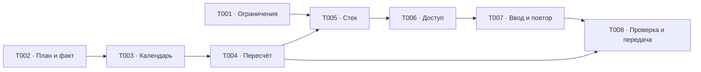

# Проверка целостности и передача технического проекта

Проектный результат [T008](../tasks/t008-design-handoff.md). Технический проект
сверен по сценариям и передан в зависимые PRD; реализация приложения не начинается
в рамках E001. Мобильные макеты E002 и условия выпуска E003 требуют собственной
приёмки до завершения S01.

## Зависимости и допустимый параллелизм

T001 и T002 независимы и допускают параллельное выполнение. После T002 следует
цепочка T003 → T004. Исследование кандидатов стека можно вести одновременно
с этой цепочкой, но окончательный T005 требует результатов T001 и T004.
T006 использует принятый стек, T007 — модель сессии и владельца T006; их нельзя
принимать раньше соответствующих входов. T008 проверяет итог T004 и T007 вместе.
Независимые проверки стандартов и требований для каждой задачи допускают параллельные
review, а исправления и приёмка её результата предшествуют следующей зависимой задаче.

## Матрица A1–A8

| Критерий PRD E001 | Принятое решение | Конкретная проектная проверка |
|---|---|---|
| A1. Согласованный стек и альтернативы | [Стек](./technology-stack.md), [ADR-0020](../../../../architecture/adr/ADR-0020-javascript-modular-monolith.md) | NestJS пригоден для общей транзакции фиксации и пересчёта; выбран с Prisma по поручению владельца. React SPA выпускается статикой; Next.js/SSR не добавляются без требуемой пользы |
| A2. Модули, операции и независимый калькулятор | [Модель](./manual-plan-and-fact.md), [доступ](./access-and-trust.md) | Калькулятор в браузере с живой сессией не запрашивает её и не читает собственный вес дневника; вход не открывает дневник без явного действия |
| A3. Намерение, факт, черновик, условия и результаты | [Модель](./manual-plan-and-fact.md), [ввод](./input-preservation.md) | `20/30/40/50/60*6-8` становится пятью подходами; первый факт фиксирует весь план, типы — с планом, подбор — при первом факте упражнения; один введённый вес остаётся черновиком |
| A4. Фиксация и исправления без подмены плана | [Календарь](./calendar-and-interruption.md), [пересчёт](./history-recalculation.md) | Исправление проходки 110×1 на 90×1 даёт актуальный МПВ 105 после следующей проходки; созданные циклы сохраняют опоры 110 и цели 115. Снятие отметок и поздняя замена не открывают исходный план |
| A5. Ввод, потеря связи, повтор и истечение | [Протокол](./input-preservation.md), [ADR-0021](../../../../architecture/adr/ADR-0021-durable-drafts-and-operation-receipts.md) | После записи и потери ответа повтор того же envelope находит квитанцию до проверки редакции; подтверждение локальной редакции 5 не удаляет набранную 6 |
| A6. Календарь без открытого приложения | [Календарь](./calendar-and-interruption.md) | Europe/Moscow и дата БД; обработчик и приведение до операций фиксируют истёкшие недели. При прерывании во вторую неделю пример даёт регулярность 4/6, будущие недели отменены; повтор не меняет дату |
| A7. Доверие и изоляция | [Доступ](./access-and-trust.md), [протокол](./input-preservation.md) | Новый VK subject с занятой почтой не получает дневник. Аккаунт Б не получает ключ черновика А и не может отправить его envelope; отзыв сессии проверяется повторно под блокировкой владельца |
| A8. Совместимость и передача | [Ограничения](./constraints.md), [стек](./technology-stack.md), таблицы передачи ниже | Одно касание сохраняет и отправляет envelope без второй кнопки; один сервер Compose обслуживает статику/API/внутреннюю БД. PRD E002–E030 содержат конкретные входы E001; копии относятся к E003/E029 |

## Сквозной проход обязательных сценариев

| Сценарий PRD | Итог проверки проекта |
|---|---|
| Первый цикл без МПВ | Создание недель, ручной план, первый зал/комплекс и факт не требуют числовой опоры или подсказки |
| Первый подход, конец недели, прерывание | Первая отметка разминки сохраняет только разминку; первый подход — всю основную часть; календарь фиксирует не начатый план; прерывание сохраняет весь остаток и отменяет будущие недели |
| Снятие отметок и поздняя замена | Снятие факта не снимает фиксацию; замена добавляет только разрешённую отдельную сторону с планом и фактом, исходные данные остаются |
| Исправление проходки и связи | Пересчёт следует хронологии и пересмотрам; при переходе личного упражнения Л от С1 к С2 прямые записи С1 остаются, МПВ в примере С1=55, С2=70 |
| Повтор после потери ответа | Факт и квитанция атомарны; повтор не создаёт новый подход, старый ответ не стирает свежую правку |
| Новый провайдер с совпавшей почтой | Требуется прежний вход/восстановление, затем явное подключение с подтверждением обоих способов; нового дневника и автоматического доступа нет |

Незавершённая копия, зафиксированная календарём, сохраняет отсутствующие значения;
их нельзя заполнить задним числом или взять из факта. Исторические условия
исправляются адресным действием, а обычная настройка действует по своим будущим
границам. Проверка доступа, блокировка владельца, часы БД, календарное приведение,
квитанция и пересчёт образуют согласованный протокол. Обычный GET не принимает
команды изменения; внутреннее календарное приведение перед чтением явно сохранено.

## Проверка входов E002 и E003

| Вход | Конкретный технический результат | Что остаётся ответственностью соседнего эпика |
|---|---|---|
| Мобильная нотация и экранная клавиатура | Исходный текст и частичная пара сохраняются как черновик; точные десятичные строки не теряют запятую при разборе | Макеты, фокус, размеры касаний и реальные мобильные браузеры E002 |
| Первое выполнение без МПВ | Ручной план и отдельный гейт разминки проходят без расчётной опоры; одно касание не требует отдельной кнопки подтверждения сети | Проверка полного мобильного потока E002 |
| Черновик/отправка/факт/ошибка | T007 задаёт русские состояния, возврат после входа, сохранность после закрытия, поздний ответ и конфликт | Визуальное представление и мобильная приёмка E002 |
| Один сервер и воспроизводимый запуск | Nest, статика и внутренняя PostgreSQL размещаются одним Compose-проектом; окружения разделяются конфигурацией, томами и секретами | Бюджет, поставщик, внешние доступы и аудитория E003 |
| Миграции и диагностика | Готовые Prisma Migrate, проверка на отдельной БД; идентификатор операции без секретов и личных записей | Подробный порядок выпуска и проверка неуспеха E003/E006/E029 |
| Резервное копирование | Копии исключены из E001; [проект и параметры](../../e003-release-design/design/release-and-recovery.md) заданы в E003, фактические гарантии проверяются в E029 | Согласование и проверка E003/E029 до выпуска сохраняются; текущая работа их не закрывает |

Это проверка совместимости конкретных технических решений с входами E002/E003,
а не утверждение готовности их макетов или эксплуатации.

## Передача в зависимые PRD

| Получатель | Переданные решения |
|---|---|
| E002–E003 | UI/ввод и календарная зона; Compose, разделение окружений, секреты, диагностика и текущая граница бэкапов |
| E004–E006, шаг S02 | TypeScript, React SPA/Vite, NestJS, Ant Design/Tailwind, Prisma/PostgreSQL, миграции, независимые точки входа, транзакции и протокол черновиков |
| E007–E008 | Память вкладки калькулятора без API, аккаунта и хранилища дневника |
| E009–E011 | Серверные сессии PostgreSQL, подтверждение/восстановление почты, безопасное подключение провайдеров, owner всех объектов |
| E012–E014 | Исходные идентификаторы упражнений, исторические условия, просмотр и подтверждение связи по редакции |
| E015–E018 | Календарь и прерывание, структура плана/нотации, копия без весов, отдельная фиксация разминки |
| E019–E020 | Неизменяемая команда, квитанции, локальные редакции и безопасная правка истории |
| E021–E023 | Хронология МПВ и пересмотров, сохранение целей, тип при фиксации, подбор при первом факте |
| E024–E027 | Согласованный пересчёт и чтение производных данных, ограничения владельца |
| E028–E030 | Проверочные сценарии, выбранное размещение и диагностика; условия выпуска и восстановления не объявлены выполненными |

## Проверка и продолжение

Для каждой задачи отдельно применён `implement`: подготовлен результат, проверены
критерии и проведены независимые review требований и стандартов. Результат T008 проверен отдельно по требованиям и стандартам.
Проверки типов, одиночные и полные тесты приложения неприменимы: в согласованном
объёме есть только документация, исходный код и зависимости не создавались.
Проверяются относительные ссылки, канонические термины и согласованность реестров.

E002 завершён, локальный E004 принят. Локальный E005 разрешён до завершения E003
по [исключению PRD E005](../../e005-storage-foundation/prd.md), раздел 3; внешние
интеграции, удалённая инфраструктура и выпуск не разрешены. Блокер внешних доступов
E003 сохраняется, E003/S01 не завершены. PLAN-Q1 и PROGRESS-Q1
остаются в своих реестрах и должны решаться в соответствующих функциональных эпиках.

## Связанные документы

- [PRD E001](../prd.md), [T008](../tasks/t008-design-handoff.md), [карточка и реестр задач](../README.md).
- [Реестр эпиков](../../README.md), [общий план](../../../README.md).
- [E002](../../e002-mobile-experience/prd.md), [E003](../../e003-release-design/prd.md), [E004](../../e004-project-foundation/prd.md), [E005](../../e005-storage-foundation/prd.md), [E006](../../e006-delivery-foundation/prd.md).
- [E029](../../e029-operational-readiness/prd.md) — будущая проверка эксплуатации и восстановления.
- [Глоссарий дневника](../../../../domain/training-log/CONTEXT.md), [глоссарий калькулятора](../../../../domain/calculator/CONTEXT.md).
- [PLAN-Q1](../../../../requirements/week-planning/open-questions.md), [PROGRESS-Q1](../../../../requirements/progress-analytics/open-questions.md).
- [ADR-0020](../../../../architecture/adr/ADR-0020-javascript-modular-monolith.md), [ADR-0021](../../../../architecture/adr/ADR-0021-durable-drafts-and-operation-receipts.md).
