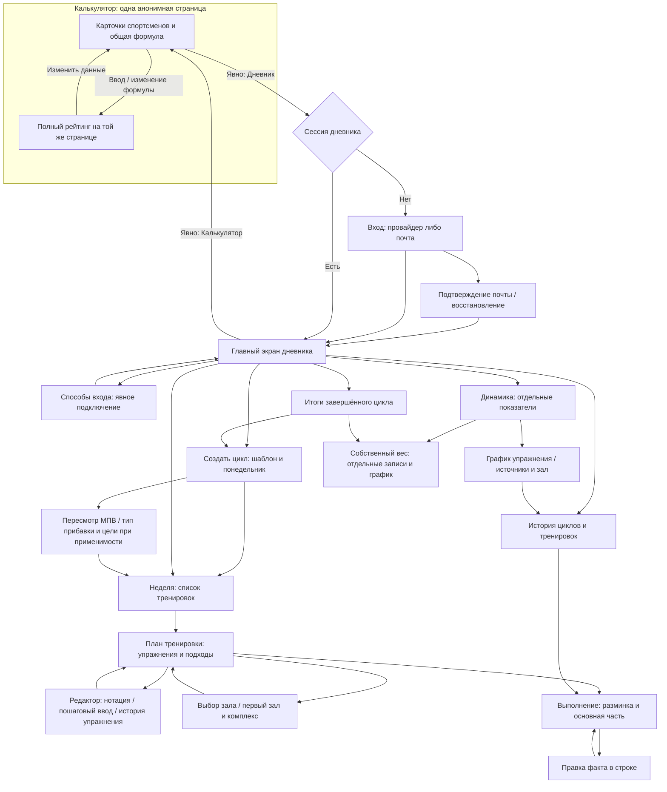

# Калькулятор, карта экранов и общий визуальный язык

Проектный результат [E002-T006](../tasks/t006-calculator-and-visual-language.md).
Документ сводит результаты T001–T005 и задаёт вход для оболочки S02. Это схемы
и правила представления; исходного кода и работающего интерфейса здесь нет.

## Границы

Калькулятор — одна страница сравнения спортсменов, работающая в памяти вкладки.
Он не проверяет сессию, не запрашивает API, не восстанавливает расчёты из хранилища
и не подставляет собственный вес из дневника. Единственная связь с дневником —
явная навигация «Дневник». Одинаковые поля и карточки не объединяют предметные данные.

Стек уже выбран в [E001](../../e001-technical-design/design/technology-stack.md):
TypeScript, React SPA/Vite, Ant Design и Tailwind CSS; сервер дневника — NestJS,
Prisma и PostgreSQL. Этот проект описывает поведение элементов, а не назначает
компонентам Ant Design предметные правила. SSR и новые зависимости не вводятся.

## Карта основных экранов



Отправка, ошибка, потеря связи и вход после истечения сессии — состояния операции
на исходном экране, а не отдельная навигационная ветка с потерей контекста.
Формула, свёрнутые карточки и рейтинг не становятся разными страницами.

| Группа экранов | Вход и главное действие | Результат и возврат | Детальные состояния |
|---|---|---|---|
| Калькулятор | Прямая ссылка; заполнить карточку | Рейтинг сразу на той же странице; переход в дневник только явно | Разделы ниже |
| Вход, почта, восстановление, подключение | Явный переход в дневник либо настройки | После проверки — тот же дневник; отмена — исходный способ/экран | [T001](./first-manual-plan.md), таблица экранов |
| Главный экран, создание цикла, неделя | Вход в дневник; создать цикл или выбрать неделю | Положение в цикле выше тренировки; назад из недели — главный экран | [T001](./first-manual-plan.md) |
| Тренировка, выбор упражнения и зала, редактор | План недели; заполнить или дополнить план | Структурный план либо видимая правка; назад — та же тренировка/неделя | [T001](./first-manual-plan.md), [T002](./quick-entry.md) |
| Выполнение, разминка и история | Тренировка либо источник в истории; отметить/исправить факт | Подтверждённый факт отдельно от плана; назад в исходный список с его позицией | [T003](./warmup-and-history.md) |
| Сохранность ввода | Любое действие дневника | Видимая редакция и правдивый статус; после прежнего входа возврат к тому же вводу | [T004](./input-preservation.md) |
| Итоги и следующий цикл | Завершённый цикл; создать следующий | Новый цикл только после явного создания; назад — итоги | [T005](./results-and-analytics.md) |
| Динамика, график и собственный вес | Навигация дневника либо итоги | Отдельные источники и графики; назад к месту входа | [T005](./results-and-analytics.md) |

Развивающий цикл без МПВ проходит создание и ручное планирование без обязательного
числового поля. Поддерживающий пропускает пересмотр МПВ и килограммовые цели.
При будущем старте выполнение недоступно до начала цикла; без активного цикла
история доступна, новая тренировка не создаётся. Карта не отменяет эти ограничения.

## Одна страница калькулятора

Сверху короткий заголовок «Калькулятор» и обычная ссылка «Дневник». Далее подпись
дисциплины «Строгий подъём на бицепс», общий выбор формулы и карточки спортсменов.
По умолчанию выбрана «Уилкс» и уже открыта одна пустая карточка. Другие варианты —
«IPF GL — адаптация для бицепса» и «DOTS»; рядом с рейтингом повторяется выбранная
формула. Смена формулы пересчитывает всех спортсменов без очистки ввода.

```text
Калькулятор                                  Дневник
Строгий подъём на бицепс
Формула: [Уилкс                         ▾]

Спортсмен 1                         [Свернуть]
Имя (необязательно): [                    ]
Пол: [Мужской] [Женский]
Собственный вес, кг: [82,5                ]
Попытки, кг
Попытка 1       Попытка 2       Попытка 3
[50      ]      [52,5    ]      [        ]
Лучшая попытка: 52,5 кг
Коэффициент: [значение] · Итог: [значение]

[Добавить спортсмена]
Рейтинг · Уилкс
Место · Спортсмен · Итог
[все спортсмены, подробности каждой строки ниже]
```

Пол не выбирается молча. Лучшая попытка видна сразу после допустимого ввода
попытки, даже без пола и собственного веса. Коэффициент и итог до достаточных
данных — прочерки. Запятая и точка равнозначны. Пустое, нечисловое, нулевое,
отрицательное значение не порождает сообщения об ошибке: оно не участвует в расчёте.
Остальные карточки продолжают рассчитываться. Неконечный итог также даёт прочерк
и отсутствие места по [calculator](../../../../requirements/calculator/index.md), R8.1.

| Состояние или действие | Наблюдаемый результат | Возврат и фокус |
|---|---|---|
| Первая пустая карточка | Все поля доступны, рейтинг содержит «Спортсмен 1» без места | Ввод остаётся на странице |
| Ввести до трёх попыток | Показана максимальная допустимая попытка; кнопки «Рассчитать» нет | Фокус остаётся в изменяемом поле |
| Добавить спортсмена | Новая пустая карточка, существующие значения не меняются | Фокус на заголовке новой карточки, следующий переход — имя |
| Свернуть заполненную карточку | Видны имя или номер, лучшая попытка, коэффициент и итог; значения не теряются | «Развернуть» возвращает поля; кнопка сообщает состояние раскрытия |
| Удалить карточку при нескольких | Удалена выбранная карточка, рейтинг пересчитан | Фокус на заголовке соседней карточки либо «Добавить спортсмена» |
| Осталась одна карточка | Удаление недоступно; текст «Должен остаться хотя бы один спортсмен» | Остальные поля и добавление доступны |
| Выбрать другую формулу | Все коэффициенты, итоги, места и лидеры пересчитаны | Фокус остаётся у выбора формулы |
| Перейти в дневник | Начинается отдельный поток T001; данные калькулятора не передаются | При новой загрузке калькулятора — одна пустая карточка |

Сворачивание не удаляет спортсмена из рейтинга и не мешает изменить формулу.
Ввод в карточках сохраняет порядок добавления и фокус, когда рейтинг пересортировывается.
Браузерная перезагрузка очищает сравнение; сохранение, восстановление сессии сравнения
и скрытая регистрация не добавляются. Обратная навигация не обещает восстановление
памяти после выгрузки страницы браузером.

## Полный рейтинг и равные итоги

На узком экране каждая строка рейтинга имеет верхнюю строку «место · имя · итог»
и подписи ниже: пол, собственный вес, лучшая попытка, коэффициент. Все значения
остаются доступны без отдельного экрана и без скрытого удаления колонок. Длинное имя
переносится; число с единицей не уезжает за границу. На более широком экране та же
информация может занимать табличные колонки. Порядок чтения остаётся построчным.

Ранжируемые спортсмены идут по убыванию неокруглённых итогов. Неполные карточки
идут после них в порядке добавления, с прочерком вместо места. Безымянный спортсмен
имеет тот же номер, что и в карточке, а не общую подпись «Без имени».

| Проверочный набор итогов | Места и выделение |
|---|---|
| `40; 40; 39` | `1; 1; 3`, оба первых имеют одинаковые рамку, знак и текст «Лидер» |
| `40.004; 40.003` | `1; 2`, лидер один; совпадение коротких подписей не меняет места |
| Два рассчитанных и один без полного ввода | Первые два ранжируются, третий виден после них без места |

Это независимые примеры порядка из R10–R12, а не обещание конкретного расчёта формулы
по произвольно выбранным весам. У совпадающих коротких подписей доступно «Показать
точнее» с пояснением «Места определены до округления». Внутри истинного равенства
порядок добавления не даёт преимущества; имя, пол, собственный вес и попытки не
становятся дополнительным критерием. Лидер обозначается текстом и знаком вместе
с цветом. Отсутствующий итог не выглядит поражением или ошибкой.

## Общий визуальный язык для S02

Основной фон — светлый нейтральный, карточки отделены границей и свободным местом.
Один спокойный акцент выделяет основное действие и выбранное состояние. Сигнальные
цвета применяются к состоянию записи и ввода, а не к оценке атлета. Зелёная заливка
не изображает факт подтверждённым до ответа сервера. Поддерживающий цикл использует
ту же иерархию и полноту экрана, что развивающий.

| Элемент | Проектное значение и поведение |
|---|---|
| Палитра темы | Фон `#f6f7f9`, карточка `#ffffff`, основной текст `#17212b`, вторичный `#556270`, граница `#c8d0da`, акцент `#2457a7`, фокус `#153f85`; цвет ошибки дневника `#a12622` используется с пояснением |
| Основной шрифт | Системный шрифт без внешней загрузки; основной текст 16/24 CSS-пикселя |
| Заголовки | Экран 24/32, раздел 20/28; перенос, а не уменьшение до нечитаемого размера |
| Подписи и статус | 14/20; единица веса и состояние не скрываются ради экономии места |
| Главное число | 24/32, среднее насыщение; табличные цифры для сопоставимых столбцов |
| Интервалы | Шкала 4/8/12/16/24; 8 между подписью и полем, 12 между связанными полями, 24 между разделами |
| Боковые поля | Обычно 16; компактная тренировка T003 — 12 для области выполнения |
| Поля и действия | Высота цели касания не менее 44, между отдельными целями не менее 8 |
| Фокус | Видимая обводка с отступом; ошибки и выбранное состояние не заменяют обводку фокуса |
| Выбор | Текст и отметка выбора вместе с границей/акцентом; у пола и формулы доступно текущее значение |
| Недоступность | Пониженное выделение и доступная текстовая причина рядом; причина не спрятана только во всплывающую подсказку |
| Ошибка дневника | Текст рядом с полем, связь с его подписью, введённое сохранено; общий статус не заменяет адресную причину |
| Подтверждение | «Подтверждено» только после ответа; локальная запись и отправка имеют собственные подписи по T004 |

Размеры — исходные значения темы, а не фиксированная высота блока с текстом.
При масштабе текста 200% высота растёт, строки переносятся, область прокручивается;
текст и фокус не обрезаются. Сохранность и смысл статуса читаются без цвета.
Порядок фокуса следует порядку полей; ошибки не перебрасывают фокус на другой
экран. Пересчёт рейтинга не забирает фокус и не озвучивает весь рейтинг на каждый
символ: достаточно доступного изменения итога текущей карточки.

Ant Design получает эти значения через тему компонентов, Tailwind отвечает за
компоновку в согласованных слоях CSS E001. Название библиотеки не считается
подтверждением мобильной пригодности. Не используются обязательная широкая таблица
подходов, цвет как единственный носитель значения и отдельная форма обычной правки факта.

## Узкий экран с клавиатурой

Проверка схем использует [условия E003](./constraints-and-validation.md): ширины
320/360/390 CSS-пикселей, тесная видимая высота 280 после открытия клавиатуры.
При ширине 320 и полях по 16 остаётся 288. Три поля попыток занимают по 88 с двумя
промежутками по 12: `3 × 88 + 2 × 12 = 288`. Их подписи расположены над полями;
при увеличении текста поля переходят в вертикальный список. Имя и собственный вес
занимают всю ширину. Одна длинная подпись не уменьшает цель касания.

```text
Калькулятор · Дневник                 44
──────────────────────────────────────
Попытки, кг                         ↕
Попытка 1  Попытка 2  Попытка 3       20
[50     ]  [52,5   ]  [      ]       44
Лучшая попытка: 52,5 кг               28
Коэффициент: … · Итог: …              40
Далее по странице: рейтинг           ↕
──────────────────────────────────────
Экранная клавиатура
```

Шапка 44, заголовок группы 20, подписи 20, поля 44, лучшая попытка 28 и итог 40
плюс пять промежутков по 8 занимают 236 из 280. Остальные поля и полный рейтинг доступны вертикальной
прокруткой на этой же странице. Выбор формулы не закрепляется поверх активного
поля. При слишком длинном тексте блок растёт и прокручивается. Клавиатура не должна
перекрывать активное поле или скрывать возможность продолжить ввод.

В калькуляторе веса используют десятичный ввод. В дневнике нотация требует символов
`/`, `*`, `-`, поэтому ей нельзя безусловно назначать клавиатуру только с цифрами.
План, факт и правка подписаны раздельно; строка следующего упражнения постоянно видна
по геометрии T003, а длинная неделя остаётся вертикальным списком по T002.

Это расчёт размеров и проход состояний на схемах. Реальные клавиатура, прокрутка,
безопасные отступы, внешний фокус и вспомогательное чтение проверяются в Safari iOS
и Chrome Android после реализации. Документ не содержит протокола успешного прогона.

## Итоговый проектный проход A1–A8

| Приёмка | Конкретный проход и результат схемы |
|---|---|
| A1 | Открыть калькулятор, добавить/свернуть карточки, увидеть полный рейтинг, явно перейти в дневник. Карта содержит вход, планирование, выполнение, историю, итоги и динамику; регистрации на калькуляторе нет |
| A2 | По T001 создать первый цикл без истории и МПВ, вручную заполнить план; по T003 пройти разминку и первую отметку. Система не требует расчётной опоры |
| A3 | По T002 ввести `20/30/40/50/60*6-8`, увидеть пять подходов; проверить подозрительную запись и заполнить копию без весов до фиксации |
| A4 | По T003 отметить `60 × 6–8` действием `60 × 6`, затем править факт в строке. Нет второй отправки, компактная строка следующего упражнения остаётся видимой |
| A5 | По T003 пройти заданную и пустую разминку, пропуск с причиной, отдельную фиксацию и исправление истории. Неполный зафиксированный план не дописывается задним числом |
| A6 | По T004 потерять запрос/ответ, получить поздний ответ при новой правке, истечь сессией и войти тем же либо другим аккаунтом. Подтверждение не выдумано, правка не потеряна и не показана чужому аккаунту |
| A7 | По T005 открыть первый МПВ, провал и поддерживающий цикл. Провал не понижает МПВ; у поддерживающего нет МПВ и числовой цели, а три показателя не получают общей оценки |
| A8 | Пройти размеры и состояния выше, T002–T005, длинные названия и неделю. Иерархия, касания, фокус, недоступность и таблицы заданы; цвет не единственный признак. Это проверка проекта, реальные браузеры остаются последующей приёмкой |

Дополнительно проверены примеры равенства `1, 1, 3`, близких неравных итогов и неполной
карточки; все они оставляют рейтинг полным. Смена формулы не переносит данные в дневник.
Открытые критерии [PLAN-Q1](../../../../requirements/week-planning/open-questions.md)
и [PROGRESS-Q1](../../../../requirements/progress-analytics/open-questions.md) не закрываются
общим визуальным языком. Их границы прямо отмечены в T002/T005.

Проверка типов и исполняемые тесты здесь неприменимы: результат — документация.
Реализация и фактический мобильный прогон относятся к E004–E028. Передача в их PRD
собирается в [общем результате E002](./design-handoff.md); готовность E002 не завершает E003.

## Связанные документы

- [PRD E002](../prd.md), [T006](../tasks/t006-calculator-and-visual-language.md), [передача E002](./design-handoff.md).
- [Первый план](./first-manual-plan.md), [быстрый ввод](./quick-entry.md), [выполнение и история](./warmup-and-history.md), [сохранность](./input-preservation.md), [итоги и динамика](./results-and-analytics.md).
- [Мобильные условия](./constraints-and-validation.md), [E003](../../e003-release-design/prd.md), [оболочка E004](../../e004-project-foundation/prd.md), [калькулятор E008](../../e008-calculator-experience/prd.md), [приёмка E028](../../e028-product-acceptance/prd.md).
- [Глоссарий калькулятора](../../../../domain/calculator/CONTEXT.md), [глоссарий дневника](../../../../domain/training-log/CONTEXT.md), [принципы](../../../../principles.md), [карта контекстов](../../../../../CONTEXT-MAP.md).
- [calculator](../../../../requirements/calculator/index.md), R1–R13; [auth](../../../../requirements/auth/index.md), R7–R8; [ADR-0009](../../../../architecture/adr/ADR-0009-calculator-is-separate-context.md), [ADR-0012](../../../../architecture/adr/ADR-0012-mobile-only-design-target.md), [ADR-0020](../../../../architecture/adr/ADR-0020-javascript-modular-monolith.md), [ADR-0021](../../../../architecture/adr/ADR-0021-durable-drafts-and-operation-receipts.md).
