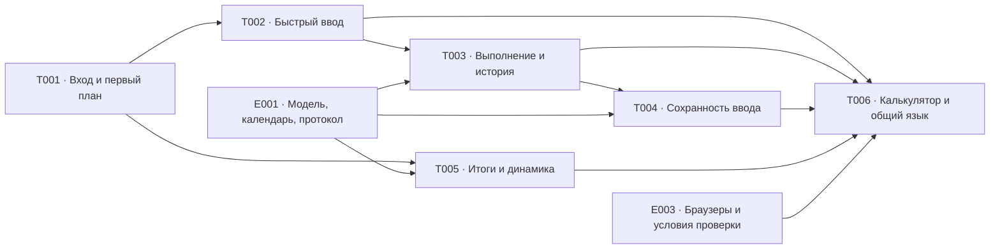

# Передача мобильных сценариев в реализацию

Результаты [E002](../README.md) — документы и схемы. Они задают мобильное поведение,
но не означают наличие приложения или успешный прогон на реальном телефоне.

## Порядок задач

После T001 задачи T002 и T005 независимы и выполняются параллельно. Цепочка
T002 → T003 → T004 последовательна: сохранность описывается для уже определённых
операций, а выполнение использует результат планирования. T006 собирает результаты
всех потоков. Подготовка технических входов и условий приёмки допустима параллельно
T001. Завершение E003 целиком не является входом E002.

## Граница технического решения

Используется принятый [ADR-0020](../../../../architecture/adr/ADR-0020-javascript-modular-monolith.md):
TypeScript в экосистеме JavaScript, статический React SPA/Vite, Ant Design, Tailwind CSS,
NestJS как модульный монолит, Prisma ORM и одна PostgreSQL. NestJS объединяет серверные
правила и транзакции дневника; калькулятор не обращается к API. SSR не нужен для
закрытых личных данных. Цена SPA — отдельная организация маршрутов, загрузки данных
и ошибок; цена NestJS — соглашения и служебный код. Сравнение альтернатив уже выполнено
в [E001](../../e001-technical-design/design/technology-stack.md).

## Проверка и передача

| Критерий E002 | Проектный результат | Проверяемый проход |
|---|---|---|
| A1–A2: первый дневник | [Вход и первый план](./first-manual-plan.md) | Явный переход из калькулятора, почта/провайдер, пустой дневник, шаблон, ручной план без истории и МПВ |
| A3: быстрый ввод | [Редактор плана](./quick-entry.md) | Предпросмотр `20/30/40/50/60*6-8`, подозрительный разбор, копия без весов, заполнение пропусков |
| A2, A4–A5: выполнение и история | [Тренировка](./warmup-and-history.md) | Пустая/заданная разминка, пропуск с причиной, одна отметка, правка в строке, постоянно видимое следующее упражнение и допустимое исправление истории |
| A6: сохранность ввода | [Состояния сохранности](./input-preservation.md) | Потеря запроса/ответа, повтор прежней команды, поздний ответ при новой правке, истечение сессии и другой аккаунт |
| A7: итоги и динамика | [Следующий цикл](./results-and-analytics.md) | Первый МПВ и провал проходки, пересмотр, поддерживающий без числовой цели, отдельные показатели и графики |
| A8: условия проверки | [Мобильная матрица](./constraints-and-validation.md) | Ширины 320/360/390, модель видимой высоты 280 с клавиатурой, фокус, длинные названия и неделя |
| A1, A8: общий результат | [Калькулятор и визуальный язык](./calculator-and-visual-language.md) | Полная карта экранов, карточки и рейтинг на одной странице, равные итоги, типографика, интервалы, фокус и состояния без опоры только на цвет |

Числовые критерии сравнения нотации с историей остаются входом
[PLAN-Q1](../../../../requirements/week-planning/open-questions.md) для E016.
Окончательный результат записи собственного веса на занятую дату остаётся входом
[PROGRESS-Q1](../../../../requirements/progress-analytics/open-questions.md) для E025/E027.
Макеты задают представление значений и незавершённой правки, но не закрывают эти
продуктовые вопросы и не разрешают молчаливо менять данные.

| Получатель | Переданный результат |
|---|---|
| [E001](../../e001-technical-design/prd.md) | Ограничения мобильной нотации, одного касания и представления протокола |
| [E003](../../e003-release-design/prd.md) | Браузеры и воспроизводимые условия будущей приёмки |
| [E004](../../e004-project-foundation/prd.md), [E005](../../e005-storage-foundation/prd.md) | Общая оболочка, мобильная матрица и состояния сохранности |
| [E008](../../e008-calculator-experience/prd.md) | Одностраничный калькулятор, полный рейтинг и независимость от дневника |
| [E009](../../e009-email-access/prd.md), [E010](../../e010-provider-access/prd.md), [E011](../../e011-private-diary/prd.md) | Вход, восстановление, явное подключение и первый дневник |
| [E015](../../e015-cycle-lifecycle/prd.md), [E016](../../e016-plan-entry/prd.md), [E017](../../e017-plan-management/prd.md) | Первый цикл, нотация, копирование и дополнение плана |
| [E018](../../e018-warmup/prd.md), [E019](../../e019-workout-recording/prd.md), [E020](../../e020-workout-history/prd.md) | Разминка, выполнение, фиксация и разрешённые исправления |
| [E025](../../e025-cycle-results/prd.md), [E026](../../e026-progress-analytics/prd.md), [E027](../../e027-bodyweight/prd.md) | Итоги, следующий цикл, динамика и отдельный собственный вес |
| [E028](../../e028-product-acceptance/prd.md) | Сквозные сценарии с обязательной записью фактических условий прогона |

Проектная проверка проходит по экранным состояниям, переходам и конкретным исходам.
Проверка типов и исполняемые тесты неприменимы: исходного кода и зависимостей нет.
Будущая проверка реализации должна отдельно подтвердить работу клавиатуры, фокуса,
прокрутки и сетевых состояний в целевых мобильных браузерах.

## Связанные документы

- [PRD E002](../prd.md), [карточка задач](../README.md).
- [Передача E001](../../e001-technical-design/design/design-handoff.md), [условия E003](../../e003-release-design/prd.md).
- [Оболочка E004](../../e004-project-foundation/prd.md), [приёмка E028](../../e028-product-acceptance/prd.md).
- [Правила документации](../../../../README.md), [глоссарий дневника](../../../../domain/training-log/CONTEXT.md), [глоссарий калькулятора](../../../../domain/calculator/CONTEXT.md).
