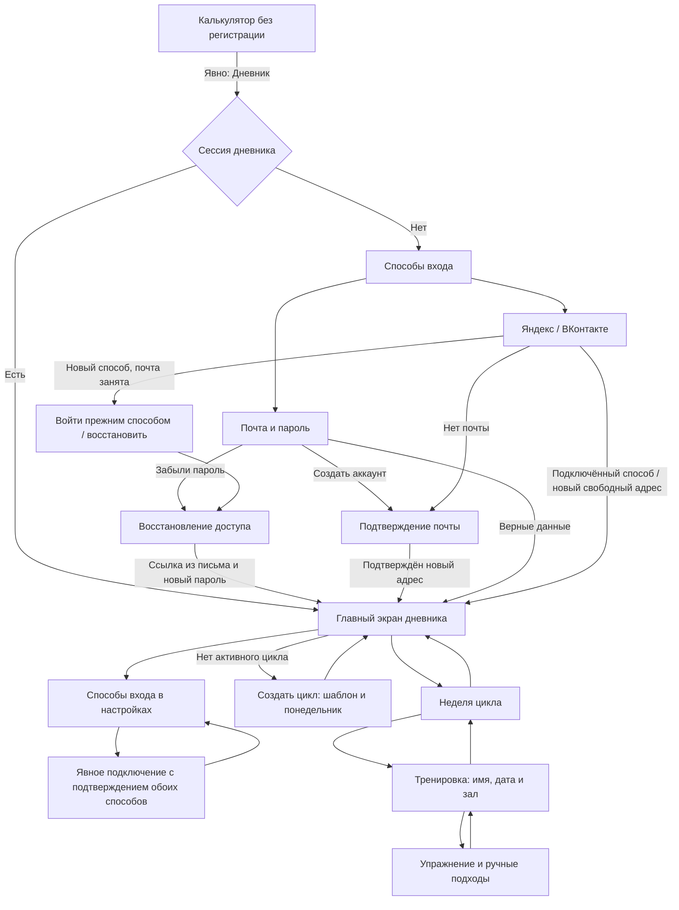

# Вход и первый ручной план без МПВ

Проектный результат [E002-T001](../tasks/t001-first-manual-plan.md). Схемы описывают
будущий интерфейс, а не работающее приложение. Основания: [auth](../../../../requirements/auth/index.md),
R3–R9, [cycle](../../../../requirements/cycle/index.md), R1–R6.1, R12.2, R19,
и [модель E001](../../e001-technical-design/design/manual-plan-and-fact.md).

## Границы

Путь начинается явным действием «Дневник» и заканчивается заполненным ручным планом.
Калькулятор остаётся отдельной страницей: не проверяет сессию, не показывает приглашений
зарегистрироваться и не читает данные дневника. Ссылка «Дневник» — обычная навигация,
одинаковая при наличии и отсутствии сессии. Успех входа завершает ранее выбранный переход
в дневник; открытый калькулятор сам не переключается после входа в другой вкладке.

Нет настройки инфраструктуры, подключения провайдеров и новой библиотеки интерфейса.
Выбранный в E001 стек не меняет последовательности действий.

## Карта переходов

Отмена внешнего входа возвращает на способы входа с сообщением «Вход отменён»;
ошибка провайдера оставляет доступными почту и повтор входа. Отмена подтверждения
или подключения не создаёт дневник и не меняет существующие способы входа.

## Экраны и возвраты

Обозначения экранов предназначены для связи с последующими схемами; это не API-маршруты.

| Экран | Вход | Основное действие | Наблюдаемый результат | Возврат |
|---|---|---|---|---|
| Вход | Явно выбран дневник без сессии | «Яндекс», ниже «ВКонтакте»; затем «Войти по почте» | Провайдер подтверждает личность либо открыта почтовая форма | В калькулятор без регистрации |
| Почта и пароль | Запасной способ на входе | «Войти»; отдельная ссылка «Создать аккаунт» | Существующий дневник открывается после успешного входа | К способам входа; адрес остаётся, пароль не восстанавливается в черновике |
| Регистрация по почте | «Создать аккаунт» | Ввести имя, почту, пароль; «Подтвердить почту» | Письмо отправлено; дневник до подтверждения не создан | К почтовому входу |
| Почта после провайдера | Провайдер не передал адрес | Ввести адрес; «Подтвердить почту» | Письмо для ожидающей регистрации; до подтверждения доступа к дневнику нет | К способам входа |
| Ожидание письма | Регистрация или отсутствующая почта провайдера | Открыть письмо; доступно повторить отправку | Ссылка подтверждает адрес и завершает регистрацию; ошибка/истечение показаны текстом | Изменить адрес в ожидающей регистрации либо вернуться ко входу |
| Почта уже используется | Новый провайдер или повторная почтовая регистрация | «Войти прежним способом» или «Восстановить доступ» | Второй дневник не создаётся, пароль и связи не меняются | К способам входа |
| Восстановление | Ссылка «Забыли пароль» или занятый адрес | Ввести адрес; «Отправить письмо» | Нейтральное подтверждение отправки, без раскрытия чужого аккаунта | К почтовому входу |
| Новый пароль | Ссылка восстановления из письма | Установить пароль | Вход в тот же дневник; подключённые провайдеры сохранены | При ошибке/истечении — повторить восстановление; при успехе — главный экран |
| Способы входа | Настройки своего дневника | «Подключить Яндекс / ВКонтакте» | Начата отдельная попытка подключения | На главный экран |
| Подключение | Явное действие в настройках | Подтвердить существующий аккаунт и новый способ в рамках этого действия | Способ добавлен к тому же дневнику; адрес восстановления не подменён | К списку способов; отмена ничего не меняет |
| Главный экран | Завершение входа либо возврат из недели | «Создать цикл», «Планировать неделю» или открыть ближайшую тренировку по состоянию | Видно положение в цикле и следующий доступный шаг | В калькулятор по явной ссылке; история доступна отдельно |
| Создание цикла | Нет активного цикла | Выбрать шаблон и допустимый понедельник; «Создать цикл» | Созданы пустые недели, показан главный экран | На главный экран без создания |
| Неделя | Выбор недели на главном экране | «Добавить тренировку» либо открыть существующую | Вертикальный список тренировок выбранной недели | На главный экран с тем же циклом |
| Тренировка | Создание в неделе либо открытие её плана | Задать имя, планируемую дату, зал; «Добавить упражнение» | Пустая или заполненная основная часть; разминка отдельным блоком | В ту же неделю; незавершённость явно обозначена |
| Упражнение и подходы | Добавление упражнения в тренировку | Выбрать упражнение из подсказок или ввести новое название; продолжить ручной план в той же строке | Новое название создаёт личное упражнение без отдельного действия; подходы показывают вес, повторения, роли и единицу веса | В ту же тренировку с сохранением позиции; подтверждение сервера отличается от черновика |

Ссылки из письма, открытые в другом браузере, следуют проверкам
[E001: доступ](../../e001-technical-design/design/access-and-trust.md): интерфейс не обещает
успех до проверки назначения, срока и браузерной привязки. При истечении ожидающей
регистрации провайдера нужен новый вход провайдером. Неудачный токен не открывает дневник.
Новый способ, уже связанный с другим дневником, показывает запрет подключения;
объединение дневников и перенос способа не предлагаются. Совпадение имени или почты
не заменяет доказательства владения. Отсутствие доступа к почте и прежнему способу
не сопровождается обещанием автоматического восстановления.

## Главный экран и первый цикл

Порядок блоков фиксирован: **положение в цикле → ближайшая тренировка → переходы
к планированию и истории**. Следующая тренировка не вытесняет цикл из первого экрана.

| Состояние | Первый блок | Действие и нижние блоки |
|---|---|---|
| Дневник пуст | «Активного цикла нет» | «Создать первый цикл»; история пуста с пояснением. Форма записи тренировки не открывается |
| Нет активного цикла, история есть | «Активного цикла нет» | «Создать цикл» и доступ к прошлым циклам; нельзя создать тренировку вне цикла |
| Цикл создан, начало впереди | «Цикл 1 · Развивающий · начнётся [дата]» | «Планировать первую неделю», первая запланированная тренировка; отметка факта и разминки недоступна с причиной «Цикл ещё не начался». Текущая неделя не выдумывается |
| Цикл начался | «Цикл 1 · Неделя 1 из 4 · Базовая» | Ниже ближайшая тренировка; если её нет — «В неделе пока нет тренировок» и «Добавить тренировку» |

Создание показывает выбранный по умолчанию «Классический 4-недельный» и его роли;
поддерживающий шаблон доступен на том же уровне. Назначение приходит с шаблоном,
отдельного переключателя назначения нет. Дата — сегодняшний понедельник либо будущий
понедельник без пересечения уже начавшихся недель прежних циклов; во вторник предлагается
следующий понедельник. Дата начала после создания не редактируется.
Перед созданием видны полные даты четырёх недель. Если другой цикл уже активен,
включая ещё не начавшийся, вместо второго создания показывается переход к нему.

Первый цикл не спрашивает МПВ, историю или цель в килограммах. Упражнение без МПВ
не получает предписания; справочный ориентир роли не превращается в вычисленный вес.
В поддерживающем цикле показаны четыре Поддерживающие недели и цель «Пройти цикл
без пропусков» без МПВ и числовых целей. Ручные рабочие веса по-прежнему вводятся.

## Первый ручной план

Для первой тренировки обязательны имя, дата в выбранной неделе и зал. Если залов нет,
создание первого зала открывается внутри выбора и возвращает в ту же тренировку.
В нём появляется пустой комплекс «Обычная»; интерфейс предлагает наполнить его,
но пустой комплекс не блокирует основную часть и не требует причины пропуска.

Поле названия показывает сначала личные упражнения атлета, затем системные.
Если нужного упражнения нет, ввод нового названия молча создаёт личное упражнение
в той же строке плана по [exercise-catalog](../../../../requirements/exercise-catalog/index.md),
R1–R2. Отдельной кнопки или перехода создания нет: атлет здесь же задаёт единицу веса
и тип и продолжает ввод подходов. Тип по умолчанию — «Вспомогательное».
У системного тип берётся из справочника. Единица «кг» или
«кг на руку» остаётся рядом с числами, а отсутствие истории выводит «Истории пока нет»
без запрета ввода. Связывание с системным упражнением не требуется для первого плана.

Пример: «Жим лёжа», единица «кг», нотация `20/30/40/50/60*6-8`.
По мере ввода видны пять подходов с повторениями 6–8: 20, 30, 40 и 50 кг —
Разминочные, 60 кг — Рабочий. Роли и числа можно исправить. Нотация и разбор находятся
рядом; отдельной кнопки «Разобрать» нет. Подозрительный разбор требует явного принятия
видимых значений. Детальные состояния ввода, дополнения и копирования раскрываются в T002.

У сохранённого плана подпись «План», у незавершённого ввода — «Черновик»;
пустой факт не заменяется плановым числом. Заполненный план остаётся редактируемым
до фиксации по [границам E001](../../e001-technical-design/design/manual-plan-and-fact.md).
Первый факт фиксирует всю основную часть, а не только выбранное упражнение;
дизайн этого действия и разминки относится к T003. План будущего цикла можно составить
сразу, а выполнение доступно только после его начала.

## Ограничения мобильного ввода для E001

Это входы для технического проекта, а не выбор компонентов: вертикальная неделя,
карточки упражнений вместо широкой обязательной таблицы, перенос длинного названия,
постоянно видимая единица веса, поддержка запятой и точки, нотации `/*-` и обычной
правки отдельных чисел. Нельзя требовать цифровую клавиатуру там, где она скрывает
символы нотации. При открытии клавиатуры активное поле и его разбор остаются достижимы
прокруткой; закреплённые действия не перекрывают поле. Переход назад не маскирует
неподтверждённый ввод как сохранённый план. Протокол черновика, ошибок и отправки
берётся из [E001](../../e001-technical-design/design/input-preservation.md), его представление — T004.

## Сценарная проверка T001

Проверка выполнена проходом схем и сопоставлением со спеками. Это проверка проекта;
прогон на устройстве, проверка типов и тестовый набор приложения здесь отсутствуют.

| Проход | Наблюдаемый результат на схеме |
|---|---|
| Открыть калькулятор без сессии, затем явно выбрать дневник | Калькулятор доступен без регистрации; вход возникает только после перехода |
| Выбрать Яндекс, отменить; выбрать ВКонтакте с отсутствующей почтой | Возврат ко входу; затем ввод адреса и письмо до создания дневника |
| Новый провайдер вернул занятую почту | Предлагаются прежний вход и восстановление; дневник не создан и не открыт по совпадению |
| Зарегистрироваться по почте, пройти письмо; повторить с занятым адресом | Новый дневник только после подтверждения; повторная регистрация не меняет пароль |
| Восстановить аккаунт провайдера по письму | Новый пароль открывает тот же дневник, провайдеры сохраняются |
| Подключить новый способ с другой почтой; отменить или выбрать занятый способ | Успех требует доказать оба способа; адрес восстановления не меняется, отмена и запрет не меняют связей |
| Создать первый цикл во вторник без МПВ и истории | Предлагается будущий понедельник; пустые недели доступны для ручного плана, выполнение пока закрыто |
| Заполнить тренировку, первый зал и упражнение с пятью подходами | Имя, дата, зал и единица видны; история не обязательна; разбор показывает конкретный план без МПВ |
| Ввести отсутствующее название упражнения, задать единицу веса и перейти к подходам | Личное упражнение создаётся при вводе названия в той же строке; нет отдельного действия создания, тип по умолчанию — «Вспомогательное» |
| Открыть начавшийся цикл либо дневник без активного цикла | Цикл выше тренировки; без цикла доступны создание и история, запись вне цикла отсутствует |
| Пройти таблицу экранов назад, включая открытую клавиатуру | У каждого экрана есть адресат возврата; состояние ввода названо отдельно от подтверждения |

## Связанные документы

- [PRD E002](../prd.md), [T001](../tasks/t001-first-manual-plan.md), [T002](../tasks/t002-quick-entry.md), [T003](../tasks/t003-warmup-and-history.md), [T004](../tasks/t004-input-preservation.md).
- [Глоссарий дневника](../../../../domain/training-log/CONTEXT.md), [глоссарий калькулятора](../../../../domain/calculator/CONTEXT.md), [принципы](../../../../principles.md).
- [auth](../../../../requirements/auth/index.md), R3–R9; [cycle](../../../../requirements/cycle/index.md), R1–R6.1, R12.2, R19.
- [week-planning](../../../../requirements/week-planning/index.md), R1–R5, R19; [exercise-catalog](../../../../requirements/exercise-catalog/index.md), R1–R2.1, R9; [warmup](../../../../requirements/warmup/index.md), R2–R4.
- [Доступ E001](../../e001-technical-design/design/access-and-trust.md), [модель плана и факта](../../e001-technical-design/design/manual-plan-and-fact.md), [календарь](../../e001-technical-design/design/calendar-and-interruption.md), [сохранность ввода](../../e001-technical-design/design/input-preservation.md).
