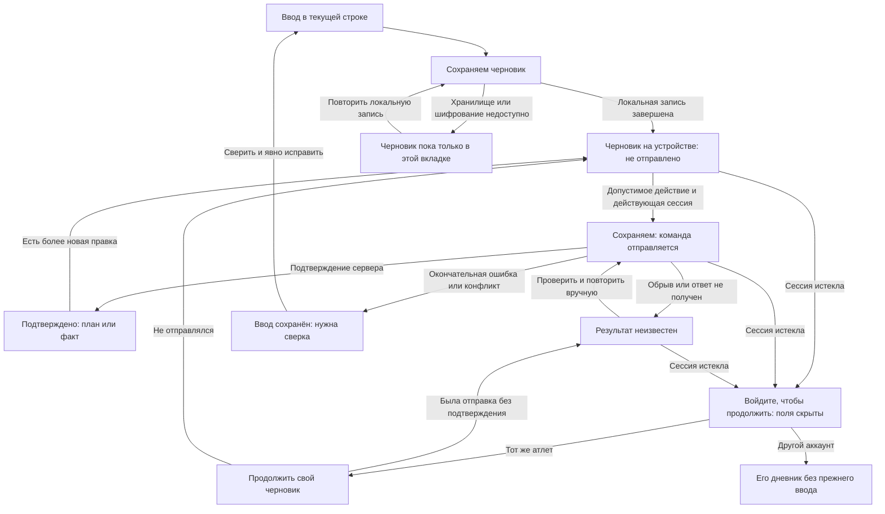

# Сохранность мобильного ввода при сбоях

Проектный результат [E002-T004](../tasks/t004-input-preservation.md), продолжение
[планирования](./quick-entry.md) и [выполнения](./warmup-and-history.md).
Основание — [протокол E001](../../e001-technical-design/design/input-preservation.md)
и [ADR-0021](../../../../architecture/adr/ADR-0021-durable-drafts-and-operation-receipts.md).
Здесь определено представление этого протокола, а не новый способ хранения или
работающий интерфейс.

## Границы

Введённый текст, черновик и подтверждённый сервером факт различаются на каждом
экране. Потеря связи оставляет ввод видимым, пока сессия допускает просмотр личных
данных. После истечения сессии поля скрываются до входа того же атлета. Это граница
приватности, а не очистка сохранённого черновика.

Нет фоновой доставки при восстановлении сети, полного оффлайн-дневника,
синхронизации устройств и создания новых тренировок без сервера. Состояния относятся
к конкретному вводу дневника. Калькулятор не получает IndexedDB, серверные квитанции,
проверку сессии или восстановление сравнения после закрытия вкладки.

## Карта состояний и возврата



Схема не означает автоматическую повторную отправку: из неизвестного результата
продолжение начинается только явным действием. При возвращении вкладки из фона
проверка сессии предшествует показу личных полей и продолжению отправки.

## Экранные состояния

Статус стоит рядом с изменяемой строкой или редактором, а не только в кратком
всплывающем сообщении. Текст и граница области сохраняют смысл без различения цвета.
Общий баннер сообщает об отсутствии сети, локальная подпись — о состоянии именно
этой правки. Баннер не объявляет все записи дневника несохранёнными.

| Экран или состояние | Вход | Основное действие | Наблюдаемый результат | Назад |
|---|---|---|---|---|
| Незавершённый ввод | Нотация `60*` или только вес факта | Дописать или исправить поля | Исходная строка и причина неполноты видны; прежний подтверждённый план/факт отдельно | В ту же тренировку, с подписью незавершённой правки |
| «Сохраняем черновик» | Изменение поля | Продолжать ввод | Текст виден; сохранность после закрытия ещё не обещана | К той же строке; уход не превращает ввод в подтверждение |
| «Черновик на устройстве · Не отправлено» | Завершена локальная запись | Применить допустимую ручную правку при доступном сервере | Подготовлена отправка этой редакции; неполный ввод отправить нельзя | В тренировку с сохранённой позицией |
| «Сохраняем» | Команда сохранена локально и отправляется | Дождаться ответа либо продолжить редактировать поля | Отправленная редакция отдельно от более новой правки; повторное касание не создаёт другую команду | В тренировку; статус операции остаётся у строки |
| «Нет связи» до отправки | Сервер недоступен, команда ещё не отправлена | Продолжить конкретный ввод; после восстановления явно применить | Поля и локальный статус остаются видны; подтверждённый факт не появляется | В текущий редактор; нет перехода к созданию новых оффлайн-тренировок |
| «Ответ не получен. Проверить и повторить» | После отправки неизвестен итог | Проверить прежнюю операцию и при необходимости повторить её | Получено исходное подтверждение либо повторена та же команда; новый подход не создаётся | В ту же тренировку с видимой неопределённостью |
| «План изменился. Сверьте правку» | Окончательный конфликт с серверным состоянием | Сверить подтверждённое состояние и введённое, затем явно исправить | Новая допустимая команда создаётся только после сверки; фиксация плана не отменяется | К прежнему вводу без его потери |
| Ошибка допустимости | Окончательный отказ, например недопустимая фактическая дата | Исправить указанное поле | Объяснение рядом с полем; прежний факт не заменён | К текущему редактору |
| «Черновик пока только в этой вкладке» | Ошибка локальной записи, квота или шифрование | «Повторить сохранение черновика» | При успехе появляется статус устройства; до него отправка не начинается | К полям; риск закрытия остаётся видимым |
| «Войдите, чтобы продолжить» | Истечение сессии, выход либо смена аккаунта | Пройти вход | Только тот же атлет получает предложение продолжить свои поля; другой — собственный дневник | К способам входа или явно в калькулятор, без раскрытия личного ввода |
| «Продолжить черновик» | Сетевой вход того же атлета после перезагрузки | Выбрать черновик и продолжить | Восстановлены поля; незавершённая отправка показана как неизвестная | В подтверждённую тренировку; черновик не смешан с ней молча |
| Подтверждённый результат | Ответ сервера для текущей операции | Продолжить выполнение или открыть историю | Отдельный подтверждённый план/факт; более новая локальная правка остаётся | К месту входа — планирование, выполнение или история |

«Применить правку» относится к ручной правке в строке из T003. Обычная отметка
подхода остаётся одним касанием: локальная подготовка и отправка выполняются внутри
него, без промежуточной кнопки «Отправить». При отсутствии связи касание оставляет
неподтверждённое намерение, а не успешную отметку.

## Схема строки при открытой клавиатуре

```text
Назад · Грудь-бицепс
Далее: Тяга верхнего блока обратным хватом
────────────────────────────────────────
Подход 5 · План: 60 кг × 6–8
Подтверждённый факт: нет
Новая правка: [60] кг [6] повторений
Ответ не получен. Проверить и повторить
[Проверить и повторить]
────────────────────────────────────────
Экранная клавиатура
```

План, прежний факт и новая правка подписаны раздельно. Значок ожидания не становится
окончательной отметкой. Если подтверждённый факт уже был, он остаётся читаемым
отдельно от новой пары. При истечении сессии скрывается вся личная карточка, включая
название упражнения, план, факт и текст ошибки с личными значениями; остаются только
сообщение о входе и общие действия.

Применяется геометрия [T003](./warmup-and-history.md): при 320 × 280 CSS-пикселях
области тренировки и следующего упражнения остаются над прокручиваемой карточкой.
Сообщение переносится, действие находится в потоке карточки и имеет цель касания
не менее 44 × 44. Баннер не закрепляется поверх активного поля. Фокус после отказа
остаётся в редактируемой строке; после возвращения того же атлета восстанавливается
место продолжения. После подтверждения сообщение читается без принудительного
скачка к началу недели. Это проверка схемы, не работа реальной клавиатуры.

## Потерянный ответ, новая правка и повтор

При неопределённом результате вес, повторения и дата отправленной команды неизменны.
«Проверить и повторить» сначала выясняет результат прежней операции и повторяет
именно её при отсутствии подтверждения. Изменённый вес нельзя отправить вместо неё
под прежним идентификатором. На экране не требуется показывать технический
идентификатор команды или устройство серверной квитанции.

Пример: отправлены 60 кг × 6, затем введены 60 кг × 7. Подтверждение первой пары
показывает «Подтверждённый факт: 60 кг × 6» и оставляет «Новая правка: 60 кг × 7».
Пока исходная отправка не разрешена, новую правку можно набирать, но нельзя
отправить. После разрешения выполняется явная сверка с актуальным состоянием;
база новой правки не подменяется автоматически.

Историческое подтверждение старой команды не заменяет уже известное более новое
серверное состояние. После смены аккаунта поздний ответ вообще не открывает прежние
поля и не меняет экран нового аккаунта. Окончательный отказ отличается от обрыва:
при отказе исправляется ввод и создаётся новая команда; при обрыве сначала
проверяется прежняя. Повтор после календарной границы не обещает разрешить запрещённую
правку: сервер проверяет актуальные условия, если исходная команда ещё не применена.

## Закрытие вкладки и граница сохранности

После завершённой локальной записи обычное закрытие позволяет тому же атлету
продолжить черновик при следующем сетевом входе. Без сети после перезагрузки его
открытие не обещается. Если найдено несколько независимых черновиков одного объекта,
показан выбор продолжения с понятным местом ввода; они не объединяются автоматически.
Прежняя отправка без ответа восстанавливается как неизвестная, а не как новая отметка.

До завершения локальной записи закрытие может потерять последние изменения. При
недоступном хранилище прямо показано «Не закрывайте вкладку: черновик ещё не сохранён
на устройстве»; это сообщение не выдаёт предупреждение браузера при закрытии за
механизм сохранения. Если истечение сессии совпало с ошибкой IndexedDB, зашифрованный
ввод может остаться только в памяти заблокированной вкладки по протоколу E001:
личные поля скрыты, продолжение доступно после входа того же атлета, закрытие потеряет
этот ввод. Ранее подтверждённый серверный факт от ошибки не удаляется.

Очистка данных сайта, вытеснение хранилища и сбой устройства выходят за гарантию
обычного закрытия. При отсутствии локального ввода не показывается вымышленный
восстановленный факт. Ошибка чтения или расшифровки не удаляет запись молча;
показывается «Не удалось открыть черновик» и доступен повтор открытия при действующей
сессии. Другому аккаунту не показываются даже список и подписи чужих черновиков.

## Сценарная проверка T004

Выполнен проход состояний по [последовательностям E001](../../e001-technical-design/design/input-preservation.md).
Каждая проверка наблюдается на схеме; исполняемого кода, проверки типов и тестового
набора приложения здесь нет. Реальные закрытие вкладки, клавиатура и разрывы сети
проверяются после реализации по [мобильной матрице](./constraints-and-validation.md).

| Проход схемы | Наблюдаемый результат |
|---|---|
| Ввести только вес, потерять связь | Частичная пара остаётся видимой и подписана незавершённой; нет нового факта |
| Одним касанием отметить подход при действующей сессии | Локальная запись, отправка и подтверждение последовательно меняют подпись, второй кнопки отправки нет |
| Потерять запрос до сервера, затем явно повторить | Прежняя команда даёт один результат; нет дополнительного подхода |
| Сервер сохранил факт, ответ потерялся | Показана неопределённость; проверка возвращает исходное подтверждение без второй записи |
| Вернуть сеть и ничего не нажимать | Нет фоновой доставки; доступно ручное продолжение |
| Во время отправки 60 × 6 набрать 60 × 7 | Ответ первой редакции оставляет новую правку, не выдаёт её за сохранённый факт |
| Сверить конфликт после другой вкладки или календарной фиксации | Актуальный план и ввод раздельны; запрещённый план не открывается для правки |
| Попытаться впервые записать поздний факт в неполную копию с уже зафиксированным планом | Серверный отказ оставляет пару черновиком; отсутствующий план не дописывается, новый факт не появляется |
| Получить окончательный отказ по будущей дате | Ошибка у даты, ввод не очищен; новая команда возможна после исправления |
| Получить отказ локальной записи до отправки | Ввод только в текущей вкладке, есть повтор локального сохранения и риск закрытия; сеть не отправляет неподготовленную команду |
| Закрыть после локального сохранения, войти тем же атлетом | Восстановлен свой черновик; отправка без ответа требует проверки прежнего результата |
| Перезагрузить без сети | Нет обещания открыть локальный дневник или расшифровать черновик без входа |
| Истечение сессии во время правки | Поля и личные подписи скрыты; после прежнего аккаунта ввод восстанавливается и продолжается в том же месте |
| Войти другим способом в тот же аккаунт | Доступно продолжение того же черновика, новый дневник не создаётся |
| После выхода А войти как Б, затем получить старый ответ А | Ни поля, ни список черновиков А не видны; ответ не меняет экран Б |
| Истечение сессии и отказ IndexedDB, затем закрытие | Личные поля скрыты; явно обозначено отсутствие сохранности после закрытия, успешное восстановление не обещано |
| Открыть калькулятор с живой либо истёкшей сессией дневника | Нет проверки сессии, восстановления локальных расчётов или записи в хранилище дневника |

## Связанные документы

- [PRD E002](../prd.md), [T004](../tasks/t004-input-preservation.md), [выполнение и история](./warmup-and-history.md), [быстрый ввод](./quick-entry.md).
- [Протокол E001](../../e001-technical-design/design/input-preservation.md), [доступ](../../e001-technical-design/design/access-and-trust.md), [календарь](../../e001-technical-design/design/calendar-and-interruption.md).
- [ADR-0021](../../../../architecture/adr/ADR-0021-durable-drafts-and-operation-receipts.md), [глоссарий дневника](../../../../domain/training-log/CONTEXT.md), [глоссарий калькулятора](../../../../domain/calculator/CONTEXT.md).
- [workout-execution](../../../../requirements/workout-execution/index.md), раздел «Риск: потеря связи»; [auth](../../../../requirements/auth/index.md), R3–R9.
- [Условия проверки](./constraints-and-validation.md), [хранение E005](../../e005-storage-foundation/prd.md), [запись E019](../../e019-workout-recording/prd.md), [приёмка E028](../../e028-product-acceptance/prd.md).
