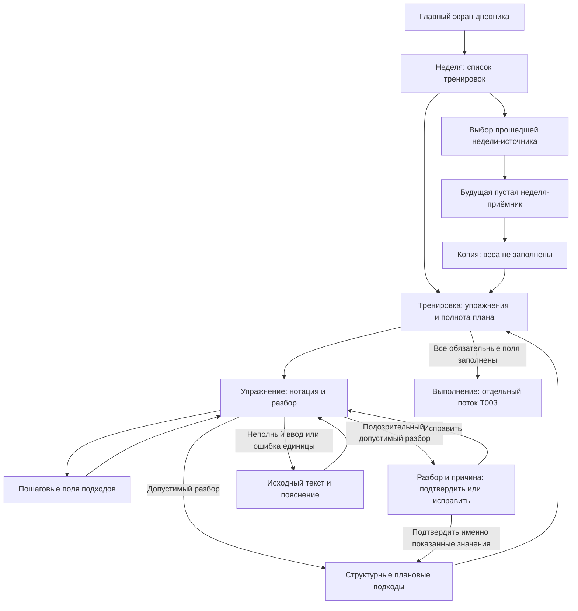

# Быстрый ввод и дополнение плана

Проектный результат [E002-T002](../tasks/t002-quick-entry.md). Продолжает
[первый ручной план](./first-manual-plan.md) и задаёт вход для выполнения тренировки.
Основания: [week-planning](../../../../requirements/week-planning/index.md), R1–R13,
R19–R20.1 и §7; [модель E001](../../e001-technical-design/design/manual-plan-and-fact.md).
Это схемы будущего интерфейса, а не работающий редактор.

## Границы

Редактор доступен внутри активного цикла для ещё не зафиксированного плана.
Отсутствие истории упражнения, МПВ или предписания не мешает ручному вводу.
В поддерживающем цикле предписания нет; история остаётся подсказкой.
Копия создаёт структуру без весов и без факта. Нотация не заменяет пошаговый ввод.
Правила фиксации, исторические условия и серверный протокол берутся из E001.

## Экраны и переходы



| Экран или состояние | Вход | Основное действие и результат | Назад |
|---|---|---|---|
| Неделя | Неделя из главного экрана | Выбрать тренировку; видны имя, планируемая дата и число незаполненных значений | Главный экран с положением в цикле |
| Тренировка | Строка недели или результат копирования | Выбрать упражнение, добавить упражнение, перейти к следующему незаполненному весу | Та же неделя с сохранённым положением прокрутки |
| Редактор упражнения | Карточка упражнения | Ввести нотацию; увидеть разбор по мере ввода и изменить роль касанием | Та же карточка тренировки; неподтверждённая редакция обозначена отдельно |
| Пошаговый ввод | Постоянное действие рядом с нотацией | Менять вес, повторения и роль конкретного подхода без знания синтаксиса | Редактор того же упражнения, без потери введённых значений |
| Подозрительный разбор | Допустимая запись, требующая подтверждения | Прочитать точные строки и причину, подтвердить показанную редакцию либо исправить её | В поле нотации с прежним текстом |
| Ошибка или частичный ввод | Незавершённая строка, недопустимый плюс или неполное число | Дополнить или исправить исходный текст; прежний подтверждённый план не заменён | В тренировку с подписью незавершённой правки |
| Выбор источника и приёмника | «Скопировать неделю» | Выбрать допустимые недели; перед действием видны обе недели и подпись «Веса не копируются» | Из приёмника к источнику, из источника в исходную неделю |
| Неполная копия | Сервер подтвердил создание структуры | Заполнить отсутствующие веса по очереди; подсказки ничего не подставляют сами | Список недель; неполнота остаётся видна |

Переход назад не означает сетевого подтверждения. Состояния локальной записи,
отправки и ответа отражаются по [протоколу E001](../../e001-technical-design/design/input-preservation.md)
и конкретизируются в [T004](../tasks/t004-input-preservation.md).

## Разбор перед принятием

Над полем видны полное название упражнения и единица веса. Под ним постоянно
подписан порядок: «Вес × повторения × число подходов». Нотация разбирается сразу,
без кнопки «Разобрать». Результат — вертикальные строки с номером, весом, повторениями
и словом роли. Это предпросмотр структурного плана, а не записанный факт.

| Ввод | Показанный разбор |
|---|---|
| `20/30/40/50/60*6-8`, единица «кг» | Пять подходов: 20, 30, 40, 50, 60 кг, у каждого 6–8 повторений; первые четыре разминочные, последний рабочий |
| `60*8*3` | Три рабочих подхода по 60 кг × 8; третье число означает количество подходов |
| `4*10` | Один подход 4 кг × 10, без догадки о четырёх подходах |
| `10/12/14/16/16/14/12*6-8` | Семь подходов: три разминочных, два рабочих по 16 кг, два добивающих; у каждого 6–8 повторений |
| `9*мах` | Один отказной подход 9 кг «до отказа»; планового числа повторений нет |
| `27,5*8` и `27.5*8` | Один подход 27,5 кг × 8; оба десятичных разделителя равнозначны |
| `30+30*8`, единица «кг на руку» | Один рабочий подход 30 кг на руку × 8; не 60 кг |
| `30*8`, единица «кг на руку» | Тот же план: 30 кг на руку × 8 |
| `30+30*8`, единица «кг» | «Запись с плюсом подходит только для кг на руку»; подход из этой строки не создаётся |
| `30+28*8`, единица «кг на руку» | «Укажите одинаковый вес в обеих руках»; нельзя подтвердить усреднение или сумму |
| `60*` | Исходная строка остаётся: «Допишите повторения»; нет придуманного числа и нового факта |

Роль назначается по [ADR-0007](../../../../architecture/adr/ADR-0007-set-roles-peak-rule.md)
и доступна для правки касанием до фиксации плана. Правка факта позднее не пересчитывает
роли по фактическому весу. Отказной подход сохраняет свою роль независимо от пика.

Отдельный блок «Проверьте разбор» показывает **все** полученные строки, причину и
действия «Подтвердить эти значения» / «Исправить». Например, `60*8*11` даёт одиннадцать
подходов и предупреждение «Больше десяти подходов». При шаге оборудования 2,5 кг
`61*8` показывает предупреждение о некратности шагу, но допускает явное подтверждение.
Недопустимая запись с плюсом отличается от такого предупреждения: у неё нет действия
подтверждения до исправления записи или выбора упражнения с подходящей единицей.
Любая правка подозрительной строки требует проверки уже нового разбора: прежнее
подтверждение не относится к изменённым значениям.

Диалог также принимает причину сравнения с историей, но пороги «резко» и «в разы»
не изобретаются в макете: это [⚠PLAN-Q1](../../../../requirements/week-planning/open-questions.md),
вход для E016. Здесь проверяются известные причины, представление сравнения и явное
подтверждение; числовая граница срабатывания истории не объявляется проверенной.

## Подсказки рядом с вводом

Под полем веса расположен раскрываемый блок «История упражнения»: действительная
дата, план и факт последних выполнений самого упражнения независимо от дня недели.
На широкую таблицу и отдельную страницу переходить не требуется. При отсутствии
записей текст «Истории пока нет — заполните план вручную» не перекрывает поле.

Предписание при наличии показано отдельным блоком: роль недели, вес в единице
упражнения и диапазон повторений. «Применить вес» действует только на выбранные
атлетом рабочие подходы этого упражнения. «Применить повторения» — отдельное явное
действие; до каждого действия видны выбранные подходы и заменяемые значения.
Число подходов и остальные роли не меняются. Если рабочих подходов нет,
подсказка остаётся справочной и рабочий подход сама не создаёт. При расхождении
с предписанием показываются значения и отклонение без оценки и запрета ввода,
если подбор веса не активен. В активном подборе предписание остаётся справочным,
но расхождение с ним не подсвечивается и снижение веса не называется регрессом
по [max-and-progression](../../../../requirements/max-and-progression/index.md), R16.

История не копирует веса автоматически. Из неё можно прочитать прежние значения
и ввести выбранные вручную; отсутствие МПВ не представляется нулём. Вес 30 кг на руку
в истории остаётся 30 кг на руку при вводе, без умножения на два.

## Копия без весов и заполнение недостающего

Источник — заполненная прошедшая неделя, приёмник — будущая пустая неделя активного
цикла. Текущая неделя не предлагается ни в одной роли. Для недопустимой недели
показана причина рядом с названием; отмена возвращает в исходный список.
Сервер повторно проверяет допустимость при создании копии.
Источник может относиться к прошлому циклу; «прошедшая» означает календарно
закончившуюся неделю, а «заполненная» — хотя бы одну плановую тренировку, без
обязательного факта. Отменённая неделя прерванного цикла становится источником
только после календарного окончания. Чужие недели не доступны.

Копия сохраняет тренировки с именами и днями недели, порядок упражнений, отдых между
подходами, разминочные комплексы, комментарии, число и роли подходов, плановые
повторения. Даты сдвигаются по соответствующим дням недели. **Все плановые веса
пусты**, включая разминочные, добивающие и отказные подходы. Факты, RPE, отметки
разминки и обстоятельства выполнения не переносятся.

```text
Неделя 3 · будущая                 Назад
Грудь-бицепс · понедельник
План: 5 весов не заполнены

Жим штанги лёжа                 кг
1  Разминочный   Не заполнено × 6–8
2  Разминочный   Не заполнено × 6–8
3  Разминочный   Не заполнено × 6–8
4  Разминочный   Не заполнено × 6–8
5  Рабочий      Не заполнено × 6–8
[Заполнить следующий вес]
История упражнения ▾
```

«Не заполнено» отличается от нуля и от отсутствия факта. Последовательный переход
ведёт только к недостающим значениям и сохраняет контекст упражнения. Допускается
дополнить план нотацией или отдельными полями без повторного ввода всех остальных
значений. Итоговый предпросмотр позволяет проверить сохранённые роли и повторения.
После ввода одного веса счётчик становится «4 веса не заполнены» только для
соответствующей редакции; серверное подтверждение отображается отдельно.

Первый факт основной части требует заполненного плана **всей тренировки**.
При попытке перейти к отметке неполной копии виден перечень упражнений и недостающих
полей со ссылками на редактор, а не только первое ошибочное поле. Не создаются факт
и фиксация основной части из-за неудачной попытки. Отметка разминки сама по себе
не фиксирует основной план. Если план уже зафиксировал календарь, пропуски нельзя
дописать задним числом: видны сохранённые пустые значения и причина ограничения,
а допустимая работа с существующим фактом относится к T003.

## Узкий экран и клавиатура

Схемы используют [условия проверки](./constraints-and-validation.md): ширины
320/360/390 CSS-пикселей, тесная видимая высота 280 после появления клавиатуры.
При ширине 320 внешние поля по 12 оставляют 296 для карточки; значения подхода
раскладываются по двум строкам, а не сжимаются в широкую таблицу. Название
«Тяга верхнего блока обратным хватом с узкой рукоятью» переносится целиком над
полем и не вытесняет единицу веса.

```text
Назад · Тренировка       План    ← 44
Тяга верхнего блока…              ← название переносится
Единица веса: кг
Нотация [20/30/40*6-8       ]     ← поле и фокус
Разбор: 3 подхода                 ← результат рядом с вводом
1 · Разминочный · 20 кг × 6–8     ← список прокручивается
История упражнения ▾
────────────────────────────
Экранная клавиатура
```

В высоте 280 допускается вертикальная прокрутка содержимого: нельзя обещать
одновременный показ всех подходов и истории. Поле с фокусом и начало разбора
достижимы без закрытия редактора; раскрытие истории не сбрасывает текст и позицию
курсора. Шапка не перекрывает активное поле, важные действия не закрепляются под
клавиатурой. При прокрутке длинной недели открыта одна текущая карточка, соседние
сворачиваются явным действием и показывают название и полноту плана.

Нотация использует текстовую клавиатуру с доступными `/`, `*`, `-`, `+` и разделителем,
а не только цифровую. Отдельное поле веса использует десятичную клавиатуру,
повторения — целочисленную. Переход между ними не теряет исходную строку.
Цель касания — не менее 44 × 44 CSS-пикселей; фокус виден. Действия «Пошагово»,
возврат и подтверждение предупреждения доступны прокруткой при открытой клавиатуре.

## План, факт и незавершённая правка

| Слой | Подпись и вид | Что означает |
|---|---|---|
| Подтверждённый план | «План: 60 кг × 6–8», обычный текст в карточке | Последняя подтверждённая сервером редакция намерения |
| Предпросмотр | «Разбор новой записи», отдельная область под исходной строкой | Ещё проверяемая структура, не факт и не подтверждение сервера |
| Незавершённая правка | «Правка не завершена» и пояснение у поля; статус сохранности отдельно | Исходный текст или неполные значения не заменяют подтверждённый план |
| Факт в истории | «Факт: 60 кг × 6» и действительная дата | Подтверждённое выполнение, показано отдельно от плана |
| Неполная копия | «План: вес не заполнен» | Сохранённая структура без планового веса, не нулевой вес и не факт |
| Зафиксированный план | «План зафиксирован» с причиной ограничения | Нотация не редактирует прошлое намерение; разрешённая правка факта остаётся отдельно |

Текстовые подписи и границы областей сохраняют различимость без цвета. Локальная
запись и отправка не меняют подпись на «Подтверждено» до ответа сервера.

## Сценарная проверка T002

Выполнен проход схем и независимых примеров из §7 спеки; геометрия рассмотрена
по размерам выше. Фактическая работа клавиатуры и прокрутки на Safari/Chrome
проверяется после реализации. Исполняемого кода, проверки типов и тестового набора нет.

| Проверка | Наблюдаемый результат на схеме |
|---|---|
| Без МПВ и истории ввести `20/30/40/50/60*6-8` | Пять строк с ролями и диапазоном; ручное заполнение не заблокировано |
| При существующем МПВ и активном подборе ввести вес ниже предписания | Предписание доступно как справка, расхождение не подсвечено; нет сообщения о регрессе и запрета ручного ввода |
| Ввести `4*10`, затем перейти к пошаговым полям | Один подход 4 × 10; поля не превращают запись в четыре подхода |
| Ввести `60*8*11`, прочитать все строки и исправить | Предупреждение до принятия; подтверждение относится только к показанной редакции |
| Сравнить `30+30*8` для двух единиц и `30+28*8` | При «кг на руку» сохранён смысл 30; несовместимые записи требуют исправления |
| Ввести `27,5*8`, затем оставить `60*` | Десятичное значение допустимо; частичный текст не создаёт готовый подход |
| Скопировать прошедшую заполненную неделю в будущую пустую | Структура и повторения перенесены, веса и факт отсутствуют; текущая неделя исключена |
| Дополнить один вес копии и попробовать первую отметку | Остальные пропуски перечислены; факта и фиксации основной части нет |
| Принять вес предписания выбранных рабочих подходов | Повторения требуют отдельного действия, число подходов и остальные роли не меняются |
| Пройти три тренировки по восемь упражнений с шестью подходами при ширине 320 и высоте 280 | Вертикальный список, длинное название над полем, текущая карточка и возврат достижимы; горизонтальная таблица не нужна |
| Вернуться из незавершённой строки и открыть историю | Правка подписана отдельно; план и факт различаются без цвета, дата факта видна |
| Открыть неполную копию после календарной фиксации | Нет дописывания весов задним числом; показаны причина и исходные пропуски |

## Связанные документы

- [PRD E002](../prd.md), [T002](../tasks/t002-quick-entry.md), [T003](../tasks/t003-warmup-and-history.md).
- [Первый план](./first-manual-plan.md), [условия мобильной проверки](./constraints-and-validation.md).
- [Глоссарий дневника](../../../../domain/training-log/CONTEXT.md), [принципы](../../../../principles.md).
- [week-planning](../../../../requirements/week-planning/index.md), [exercise-catalog](../../../../requirements/exercise-catalog/index.md).
- [Модель E001](../../e001-technical-design/design/manual-plan-and-fact.md), [протокол ввода](../../e001-technical-design/design/input-preservation.md).
- [ADR-0006](../../../../architecture/adr/ADR-0006-structured-plan-not-text.md), [ADR-0007](../../../../architecture/adr/ADR-0007-set-roles-peak-rule.md), [ADR-0018](../../../../architecture/adr/ADR-0018-plan-and-history-boundaries.md).
