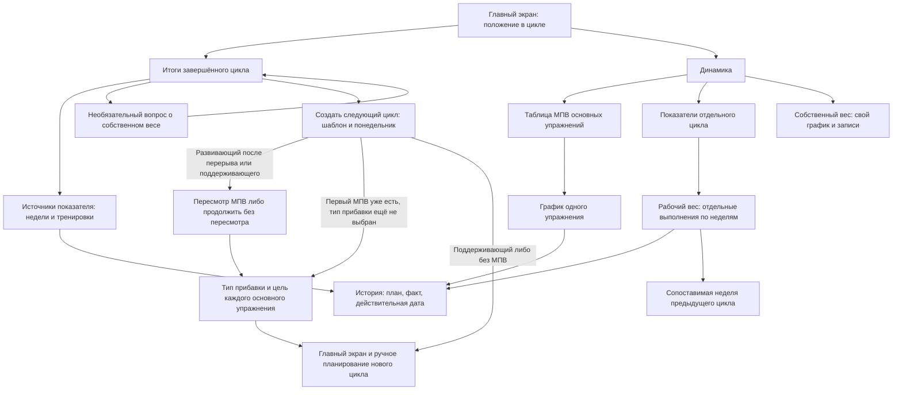

# Итоги, следующий цикл и динамика

Проектный результат [E002-T005](../tasks/t005-results-and-analytics.md). Документ
продолжает [первый ручной план](./first-manual-plan.md) и использует календарь и
пересчёт E001. Здесь описаны экраны и проверка схем; приложение не создаётся.

## Границы

Итоги помогают решить, что делать в следующем цикле. Они не создают его автоматически,
не требуют МПВ, не превращают отдельный провал или перевыполнение в оценку атлета.
Регулярность, точность плана и целостность цикла остаются тремя самостоятельными
показателями. Отдельная история доступна без активного цикла, но новые тренировки
между циклами не записываются.

Основания: [cycle](../../../../requirements/cycle/index.md), R11–R13.3, R19–R21;
[max-and-progression](../../../../requirements/max-and-progression/index.md), R5–R9,
R20–R23; [progress-analytics](../../../../requirements/progress-analytics/index.md),
R1–R19. Тоннаж, расчётный одноповторный максимум и общий график нескольких упражнений
не входят в интерфейс.

## Карта переходов

Пересмотр содержит существующие МПВ; у упражнения без МПВ нет поля для ручного создания
первой опоры. Если пересмотр пропущен, следующий цикл использует прежние значения.
Тип прибавки нужен только основным упражнениям с МПВ в развивающем цикле; отсутствие
опоры оставляет ручное планирование доступным. Поддерживающий шаблон обходит оба шага.

## Экраны и возвраты

| Экран | Вход | Основное действие | Наблюдаемый результат | Возврат |
|---|---|---|---|---|
| Итоги | Календарь завершил цикл либо выбрана запись истории | Прочитать три отдельных показателя; «Создать следующий цикл» | Видны назначение, даты, результаты и доступные источники; новый цикл ещё не создан | Главный экран или список циклов, откуда открыт результат |
| Источники показателя | Касание регулярности, точности плана или целостности | Раскрыть неделю и тренировку | Показаны участвующие записи и исключения; план и факт различимы | К тому же показателю итогов, с сохранённой позицией |
| Следующий цикл | Явное действие в итогах | Выбрать шаблон и допустимый понедельник, затем создать | Назначение следует шаблону; предварительный просмотр не занимает место цикла до подтверждения сервера | Итоги без создания нового цикла |
| Пересмотр МПВ | Перед развивающим циклом после четырёх недель без проведённых тренировок либо после поддерживающего | Пересмотреть существующее значение или включить подбор веса; доступно «Продолжить без пересмотра» | Атлет явно выбирает новую опору; автоматического снижения нет | К выбору шаблона; несохранённые значения отмечены правкой |
| Тип прибавки и цели | Создание развивающего цикла для упражнения с МПВ | Выбрать проценты, килограммы либо «Без прибавки»; проверить цель | Тип не выбран молча; видны опора, прибавка, шаг оборудования и полученная цель | К предыдущему шагу создания без потери введённого |
| Динамика до первого завершённого цикла | Навигация дневника | Посмотреть показатели текущего цикла или историю | Регулярность на первом плане; графики МПВ и рабочих весов против предписания не показываются | Главный экран |
| Таблица МПВ | Динамика после первого завершённого цикла | Выбрать основное упражнение | В строке текущее значение, изменение за последний цикл и дата; при отсутствии МПВ — «Ещё не установлен» | Раздел динамики |
| График упражнения | Строка таблицы МПВ | Выбрать точку и открыть её источник | Один график одного упражнения; дата, зал, источник и исправление доступны текстом | Таблица на той же строке |
| Рабочий вес по неделям | Упражнение в развивающем цикле | Раскрыть выполнение и подходы | Отдельно предписание, диапазон плановых рабочих весов и фактический рабочий вес с датой; несколько выполнений не усредняются | Показатели выбранного цикла |
| Сопоставимая неделя | Действие у недели | Открыть тот же номер и роль предыдущего цикла | Сравниваются одинаковые роли; при отсутствии пары — объяснение вместо подстановки произвольной недели | Исходная неделя с сохранённой позицией |
| Собственный вес | Самостоятельный пункт динамики либо ссылка из вопроса итогов | Добавить дату и значение, сохранить | Отдельные записи и график; поле не связано с упражнениями и калькулятором | К месту входа: динамика либо итоги |

Новый цикл начинается сегодня, только если сегодня понедельник и неделя допустима;
иначе предлагается будущий понедельник. После прерывания в начавшуюся неделю — не раньше
следующего понедельника. До подтверждения создания ввод остаётся правкой, после ответа
сервера новый цикл занимает единственное место активного цикла. Истёкший цикл завершает
сервер по датам; кнопки «Закончить цикл» и «Завершить неделю» не добавляются.

## Итоги развивающего цикла

Вертикальный порядок: название, назначение и даты → три показателя → итоги проходки
по основным упражнениям → необязательный собственный вес → «Создать следующий цикл».
У каждого показателя своя подпись, значение и раскрываемое объяснение:

| Блок | Пример | Как читается |
|---|---|---|
| Регулярность | «Проведено 10 из 12 · 83,3%» | Какие тренировки проведены в своей неделе; число не смешивается с точностью |
| Точность плана | «Точных рабочих подходов 30 из 40 · 75%» | Только участвующие плановые рабочие подходы основных упражнений; исключения доступны отдельно |
| Целостность цикла | «Да» либо «Нет», с причиной | Каждая непустая неделя прошла в своей роли; провал состоявшейся проходки сам по себе не нарушает целостность |

Если участвующих записей нет, регулярность или точность показываются прочерком с
пояснением, а не выдуманными 0%/100%. Пока цикл идёт, целостность — «— · Цикл ещё идёт»;
до старта — «— · Цикл ещё не начался». Предварительные показатели текущего плана
подписаны как предварительные. Сравнение с предыдущим циклом показывает каждый
показатель отдельно; прерванный цикл всегда явно помечается.

Первый МПВ устанавливается только по допустимому факту проходки после календарного
завершения развивающего цикла. Карточка примера: «Жим лёжа · МПВ установлен: 60 кг»,
ниже «Источник: проходка, 60 кг × 1, [дата]». Прибавка к первому значению не добавляется.
Тип прибавки спрашивается при следующем развивающем цикле. При подборе веса первый
МПВ допустим и задаёт исходную точку графика; повышение существующего МПВ при подборе
не предлагается. Нельзя поставить первый МПВ из памяти или из обычной недели.

При прежнем МПВ 100 кг, плане проходки 105 кг и факте 105 кг × 0 карточка показывает
«Проходка провалена. МПВ остаётся 100 кг». Ни красной аварии, ни предложения понизить
МПВ, ни оценки атлета. Действия при создании следующего: повторить шаблон, выбрать другой,
изменить тип прибавки либо выбрать поддерживающий. Если вес выше прежнего МПВ не был
запланирован, это не провал: «МПВ не изменился». Если допустимого факта нет, интерфейс
не объявляет новое достижение и даёт перейти к источнику истории.

Обычное успешное выполнение, ноль повторений и перевыполнение отдельного подхода
не вызывают оценочного сообщения на итогах. Килограммы как достижение появляются только
при обновлении МПВ в итогах проходки. Текст о непрерывности допустим только при
подтверждающей истории, например «Четвёртый цикл подряд без пропусков».

## Поддерживающий и прерванный циклы

Поддерживающий экран использует тот же полноценный порядок: назначение и даты,
регулярность, точность плана, целостность, необязательный собственный вес и создание
следующего цикла. Цель — «Пройти цикл без пропусков, сохранив уровень». Блоков МПВ,
предписаний, прибавки, проходки и числовых целей нет; отсутствие роста не оценивается.
Плановые и фактические веса остаются в истории тренировки, а не в сводке достижений.
Вопрос о собственном весе допустим: он относится к контексту атлета, а не росту МПВ.

При выборе развивающего после поддерживающего обязательно показывается шаг пересмотра
МПВ с возможностью пропустить. В общем графике упражнения поддерживающие циклы —
подписанный промежуток без проходок, не нулевая точка и не падение МПВ.

Итоги прерванного цикла подписывают дату прерывания. В показатели входят начавшиеся
недели целиком; будущие недели видны как «Отменена», не как пропуски. Целостность —
«Нет», МПВ не обновляется. Пример E001: прерывание во вторую неделю, проведено 4 из 6;
тренировки будущих недель не увеличивают знаменатель. При прерывании до старта
регулярность и точность — прочерки. История и допустимое исправление факта доступны;
действительная дата факта не может быть позже даты прерывания.

## Динамика и источники

Четыре показателя динамики — МПВ по циклам, рабочий вес по неделям, регулярность
и точность плана. Целостность показывается в итогах отдельно как показатель соблюдения.
На телефоне сводная таблица МПВ представлена вертикальными строками: длинное название
переносится, под ним дата и изменение, значение с единицей не обрезается. В единице
«кг на руку» числа не удваиваются. Не требуется читать широкую таблицу всех упражнений
или легенду нескольких линий.

График выбранного упражнения показывает одну линию. Точка с другим залом получает
маркер и текст «Зал: Спарта» в подробностях; линия не разрывается, поправка к весу
не вводится. Под графиком доступны те же точки списком с датой, единицей и источником,
поэтому сведения доступны без точного попадания в точку. Исправленный МПВ строится
по действующим источникам; рядом метка «Исправлено», доступна история исправления.
Ошибка не остаётся достижением и её исправление не празднуется.

В рабочих весах пример `80 × 8`, `85 × 5`, `90 × 0` показывает фактический рабочий вес
85 кг; 90 кг остаётся провалённой попыткой в истории. Два допустимых выполнения
одной недели — две строки с датами. Подбор веса, замена, облегчённое выполнение и
вспомогательный тип исключаются по сохранённым условиям выполнения, но история
остаётся доступна. На поддерживающем экране нет рабочего веса против предписания.

Сопоставимая неделя — тот же номер и та же роль предыдущего цикла. Историческое
предписание использует сохранённую для той недели опору. Исправление факта обновляет
динамику и итоги, но не переписывает исходный план, МПВ и цель уже созданного цикла.
Если текущая опора стала недостоверной, сообщение ведёт к явному принятию исправленной
опоры для ещё не прошедших недель; введённый план не меняется автоматически.

## Собственный вес и узкий экран

В итогах вопрос появляется один раз за завершённый цикл. «Пропустить» — одно касание,
без обязательного ввода и повторных напоминаний. Сохранение показывает подтверждённую
запись только после ответа сервера. На собственном экране можно ввести значение с любой
датой; пустой график сообщает «Записей пока нет» и предлагает ручной ввод. История веса
не накладывается на упражнение и не подставляется в калькулятор.

Случай другого значения на уже занятую дату остаётся отдельным входом
[⚠PROGRESS-Q1](../../../../requirements/progress-analytics/open-questions.md) для E025/E027.
Схема показывает существующее и введённое значения раздельно и сохраняет правку;
автоматическая замена или создание второй точки здесь не предполагаются. Окончательные
действия и итог графика задаются после решения вопроса; обычная запись на свободную дату
полностью определена и не зависит от него.

При ширине 320 CSS-пикселей боковые поля 16 оставляют 288 для контента. Показатели
идут друг под другом, их числители и знаменатели не скрываются за горизонтальной
прокруткой. У поля веса и даты отдельные подписи; десятичный ввод не скрывает единицу.
При модели видимой высоты 280 CSS-пикселей заголовок 48, поле с подписью 76,
сообщение 44 и действие 44 с тремя промежутками по 12 занимают 248; остальное
достигается вертикальной прокруткой. Панель действий не перекрывает активное поле.
Клавиатура не нужна для чтения итогов; при вводе веса «Назад» возвращает к месту входа,
не изображая правку подтверждённой записью. Это геометрическая проверка схем,
а не проверка фактической клавиатуры устройства.

## Сценарная проверка T005

| Проход схемы | Наблюдаемый результат | Критерий |
|---|---|---|
| Первый цикл без МПВ, в проходке допустимые 60 кг × 1, затем конец последней недели | Первый МПВ 60 кг без прибавки; до завершения цикла опора отсутствует; следующий цикл создаётся явно | Первый МПВ |
| Прежний МПВ 100 кг, план 105 кг, факт 105 кг × 0; все недели проведены | Провал, МПВ 100 кг; целостность может быть «Да»; нет автоматического понижения и оценочной реакции | Провал и показатели |
| Нет плана выше 100 кг либо нет допустимых источников первого МПВ | Нет ложного провала или придуманной опоры, доступна история | Границы МПВ |
| После четырёх недель без проведённых тренировок выбрать развивающий | Показан пересмотр существующих МПВ; можно продолжить без него или включить подбор; первый МПВ вручную не вводится | Пересмотр |
| Завершить поддерживающий и создать следующий поддерживающий / развивающий | Три показателя без МПВ и числовых целей; при переходе в развивающий показан пересмотр | Поддерживающий |
| Открыть регулярность 10/12 и точность 30/40 | Два отдельных значения и разные источники; нет сводного процента; целостность отдельно | Показатели |
| Прервать во вторую неделю с 4 проведёнными из 6 | 4/6, будущие недели отменены, целостность «Нет», МПВ не обновляется | Календарь E001 |
| Открыть график одного упражнения с выполнением в «Спарте» | Одна линия, подпись зала, отдельный источник; единица сохранена, нет поправки | График и зал |
| Рабочие 80 × 8, 85 × 5, 90 × 0, затем второе выполнение той же недели | Поднятый рабочий вес 85; второе выполнение отдельной строкой; ноль не даёт 90 кг | Рабочий вес |
| Исправить источник проходки, затем вернуться в динамику | Текущая опора и график исправлены, план и цели созданных циклов сохранены; нет нового достижения | Пересчёт E001 |
| Пропустить вопрос веса; открыть отдельный экран и записать свободную дату | Пропуск в одно касание; запись необязательна, свой график без наложения на упражнение | Собственный вес |
| Ввести вес при ширине 320 и модели видимой высоты 280 | Поле, единица, состояние и действие доступны вертикально; длинные названия не закрывают показатели | Часть A1/A7 |

Проверка выполнена проходом состояний и числовых примеров по бизнес-правилам.
Исполняемые тесты, проверка типов и реальный браузерный прогон неприменимы к этой
документальной задаче. Проверка работающего интерфейса передаётся в E025–E028.

## Связанные документы

- [PRD E002](../prd.md), [T005](../tasks/t005-results-and-analytics.md), [первый план](./first-manual-plan.md), [условия мобильной проверки](./constraints-and-validation.md).
- [Глоссарий дневника](../../../../domain/training-log/CONTEXT.md), [принципы](../../../../principles.md).
- [cycle](../../../../requirements/cycle/index.md), R1.2, R4, R6.3, R9.4, R11–R13.3, R19–R21.
- [max-and-progression](../../../../requirements/max-and-progression/index.md), R5–R10.2, R19–R23; [progress-analytics](../../../../requirements/progress-analytics/index.md), R1–R19.
- [Календарь E001](../../e001-technical-design/design/calendar-and-interruption.md), [пересчёт E001](../../e001-technical-design/design/history-recalculation.md), [протокол ввода E001](../../e001-technical-design/design/input-preservation.md).
- [ADR-0003](../../../../architecture/adr/ADR-0003-no-tonnage-no-estimated-1rm.md), [ADR-0013](../../../../architecture/adr/ADR-0013-not-every-cycle-targets-growth.md), [ADR-0015](../../../../architecture/adr/ADR-0015-gym-does-not-affect-max.md), [ADR-0019](../../../../architecture/adr/ADR-0019-interrupted-cycle-metrics.md).
- [Итоги E025](../../e025-cycle-results/prd.md), [динамика E026](../../e026-progress-analytics/prd.md), [собственный вес E027](../../e027-bodyweight/prd.md), [приёмка E028](../../e028-product-acceptance/prd.md).
