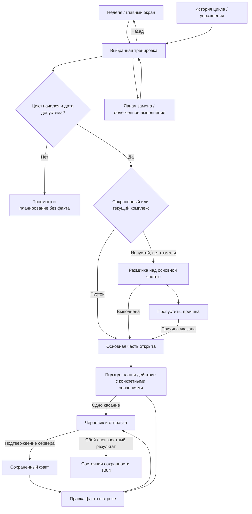

# Разминка, отметка подхода и исправление истории

Проектный результат [E002-T003](../tasks/t003-warmup-and-history.md). Вход —
[ручной план](./first-manual-plan.md) и [быстрый ввод](./quick-entry.md).
Здесь определены экраны и наблюдаемые переходы, а не код приложения.

## Границы

Разминка, основная часть и история остаются на экране выбранной тренировки.
Разминка не смешивается с разминочными подходами основной части. У разминочного
упражнения есть минуты либо повторения по [warmup](../../../../requirements/warmup/index.md),
раздел 5; это не основание добавлять длительность или собственный вес в поля факта
основного подхода. Основной факт — вес в единице упражнения и целое неотрицательное
число повторений. Таймеры, фактический отдых и новые виды упражнений не добавляются.

Состояние тренировки выводится из факта и календаря; кнопки «Завершить тренировку»
и ручного выбора статуса нет. До начала цикла доступны план и комплекс, но не
отметки выполнения и пропуска. История и разрешённые исправления доступны и без
активного цикла. Источники — [workout-execution](../../../../requirements/workout-execution/index.md),
R1–R5, R10.2–R17, и [границы плана](../../../../requirements/week-planning/index.md), R19.1–R19.5.

## Карта переходов



Возврат из тренировки, открытой через историю, ведёт в тот же список с сохранением
фильтра и позиции, а не обязательно в текущую неделю. Незавершённая правка при
возврате следует протоколу T004 и не изображается подтверждённым фактом.

## Экраны и локальные состояния

| Экран или область | Вход | Основное действие | Результат | Возврат |
|---|---|---|---|---|
| Тренировка | Главный экран, неделя либо история | Просмотреть дату и открыть подход | Сверху разминка, ниже упражнения с планом и фактом | В исходную неделю/историю |
| Разминка без отметки | Непустой комплекс, цикл начался | «Разминка выполнена» | После подтверждения комплекс свёрнут, основная часть открыта | Остаться в тренировке |
| Пустая разминка | Пустой комплекс, в том числе первый «Обычная» | При первом предложении «Наполнить комплекс» либо продолжить | Основная часть уже открыта, причины пропуска не требуется | Из редактора в ту же тренировку |
| Пропуск разминки | «Пропустить разминку» | Ввести причину; «Пропустить с этой причиной» | После подтверждения видны «Разминка пропущена» и причина | Отмена закрывает ввод причины, отметки нет |
| Результаты разминки | Раскрытие разминки | Необязательно ввести минуты/повторения у своего упражнения | Отметка «Выполнена» не зависит от заполнения результатов | Свернуть блок в той же тренировке |
| Подход | Открытая основная часть, допустимый план | «Отметить 60 кг × 6» либо править факт в строке | Команда отправлена; после ответа отдельно виден факт | В ту же карточку без смены экрана |
| Правка подхода | Касание фактического веса или повторений | Ввести пару и применить правку | Подтверждённый факт остаётся виден до успеха новой записи | Отмена правки возвращает подтверждённые значения |
| История тренировки | Прошлый цикл или история упражнения | «Исправить факт» в выбранной строке | Меняется допустимый факт, исходный план остаётся | В исходный список истории |
| Явная замена | Действие у исходного упражнения | Выбрать заменяющее и отдельно задать его план/факт | Две связанные стороны с сохранением исходных записей | Отмена до сохранения — исходное упражнение |
| Облегчённое выполнение | Действие у упражнения | Указать обязательную причину | После подтверждения пометка с причиной в истории | Отмена сохраняет прежнее состояние |

## Разминка и две границы фиксации

Непустой комплекс до отметки показывает имя, состав и цели; основная часть видна
для ориентации, но новые отметки недоступны с пояснением «Отметьте разминку или
укажите причину пропуска». После отметки блок сворачивается в «Разминка выполнена»
либо «Разминка пропущена · [причина]» с возможностью раскрыть и исправить.
Необязательные результаты, например «Пресс: 20/20/17 из 3 по 20», доступны внутри.
Отставание от цели не выделяется как нарушение.

У пустого комплекса надпись «В комплексе пока нет упражнений». Предложение наполнить
его показывается один раз, не становится постоянным барьером и не создаёт выдуманного
пропуска. До первой фиксации учитывается актуальный комплекс, после неё — сохранённый.
Если пустой комплекс был сохранён для старой тренировки, наполнение общего комплекса
сегодня не закрывает основную часть и не требует отметки в этой старой тренировке.

| Событие | Разминка | План основной части |
|---|---|---|
| Выполнение или пропуск разминки | Состав и цели фиксируются | Остаётся редактируемым до своей границы |
| Первый подтверждённый подход основной части | Фиксируется, если ещё не фиксировалась | Фиксируются все упражнения, подходы, роли, плановые числа и типы упражнений |
| Конец календарной недели либо прерывание | Фиксируется и при отсутствии отметки | Фиксируется и незавершённая копия без весов |
| Снятие всех отметок | Сохранённый комплекс не подменяется текущим | План не открывается заново |

Если атлет снимает ошибочную отметку непустой разминки, виден текст «Нет отметки».
Существующие подходы остаются видимыми и исправляемыми; перед записью новых
предлагается выполнить разминку либо указать причину пропуска. История не утверждает,
что атлет не размялся. Для пропуска пустая причина не отправляется; введённый текст
остаётся в поле до исправления или отмены. Эти ограничения следуют [warmup](../../../../requirements/warmup/index.md), R2, R2.2, R5–R6.

Собственный индикатор разминки остаётся только на экране тренировки: например,
«Разминка выполнена в 4 из 5 тренировок с заданным комплексом этого цикла — 80%».
При отсутствии участвующих тренировок — прочерк с пояснением. Тренировки только
с разминкой и тренировки с пустым сохранённым комплексом в долю не входят.
Поздняя правка пересчитывает её по [warmup](../../../../requirements/warmup/index.md), R9;
минуты и повторения не складываются в общий процент, показатели цикла не меняются из-за разминки.

## Одно касание и правка на месте

Карточка упражнения показывает полное название, единицу веса, комментарий именно
этого упражнения и заданный отдых между подходами. Таймера нет. Подход содержит
две подписанные области: «План» и «Факт». В исходном состоянии факта нет, а действие
показывает конкретные значения, которые запишет. Для плана 60 кг × 6–8 это
«Отметить 60 кг × 6»; для фиксированных 8 повторений — «Отметить 60 кг × 8».

Одно касание подготавливает локальный черновик и отправляет команду по
[протоколу E001](../../e001-technical-design/design/input-preservation.md) без второй
кнопки отправки или подтверждения первого подхода. До ответа текст «Сохраняем»
не заменяется окончательной отметкой. Повторное касание не создаёт новую команду.
Отдельная кнопка подтверждения подозрительного разбора из T002 относится к
планированию и не добавляется к обычной отметке подхода.

У отказного подхода показан плановый вес и «До отказа»; число повторений атлет вводит
сам, после чего применяет введённую пару. Одно касание здесь не выдумывает результат.
Для отличающегося выполнения достаточно коснуться поля факта в той же строке:
вес и повторения раскрываются прямо под планом, без модального окна и отдельной
страницы. «Применить правку» относится к этому ручному вводу. Незавершённая пара,
например вес без повторений, остаётся черновиком и не стирает прежний факт.

Факт `60 кг × 0` — отмеченная провалённая попытка; «Нет факта» — подход не отмечен.
Нулевые повторения не выглядят пустым полем. «Снять отметку» удаляет факт явно,
но не исходный план и не фиксацию. RPE 1–10 необязателен и расположен один раз у
упражнения, комментарий к тренировке — отдельно; они не заменяют отметку подхода.
Нет оценочной реакции на недовыполнение или перевыполнение.

```text
Грудь-бицепс · Фактическая дата: сегодня
Разминка выполнена ▾

Жим штанги лёжа · кг
Комментарий к упражнению: [текст]
Подход 5 · Рабочий
План: 60 кг × 6–8
Факт: нет
[Отметить 60 кг × 6]   [Ввести иначе]

Далее: Тяга верхнего блока обратным хватом
```

## Следующее упражнение и экранная клавиатура

«Далее: [название]» постоянно видно в компактной области над прокручиваемой
карточкой выполнения, в том числе при правке и открытой клавиатуре. Это не ссылка,
которую нужно искать внизу списка. Если упражнения больше нет — «Последнее упражнение».
Смена позиции в списке обновляет эту область, не отмечая соседний подход автоматически.
Действие перехода ведёт к следующему упражнению, но не переносит туда несохранённый факт.

Для схемы 320 × 280 CSS-пикселей после открытия клавиатуры внешние поля по 12
оставляют ширину 296. Верхняя область текущей тренировки занимает 44 пикселя,
строка следующего упражнения в две строки — до 60, остальное — прокручиваемая
карточка. В ней план, поля и действие идут вертикально; активное поле не закрывается
закреплённой строкой. Поля и действия имеют цель касания не менее 44 × 44.
Длинное название текущего упражнения переносится; сокращённая шапка не заменяет
полное название внутри карточки. Увеличение текста проверяется отдельно: служебная
шапка уступает место вводу, область «Далее» остаётся читаемой, без наложения на поля.

```text
Назад · Грудь-бицепс                 44
Далее: Тяга верхнего блока
обратным хватом                      60
──────────────────────────────────────
План: 60 кг × 6–8            ↕ карточка
Факт: [60   ] кг  [6    ] повторений
[Применить правку]  [Отмена]
Сохраняем / подтверждённый прежний факт
──────────────────────────────────────
Экранная клавиатура
```

Это геометрический проход схемы по [условиям проверки](./constraints-and-validation.md),
а не результат запуска Safari/Chrome. Реальная прокрутка, безопасные отступы,
изменение видимой области и фокус принимаются после реализации.

## История: намерение, действительная дата и обстоятельства

История открывает ту же тренировку с видимыми планируемой и фактической датами.
Время ввода не выдаётся за дату выполнения. При первом факте предложено «Сегодня»
с явной календарной датой; для поздней записи атлет выбирает действительную дату.
Допустимый интервал — от начала цикла до сегодня, а для прерванного цикла ещё и
не позже даты прерывания. Календарь использует Europe/Moscow по E001. Ошибочная
дата показывает причину рядом с полем, не заменяет прежний допустимый факт и не
влияет на показатели. Новое выполнение до начала цикла недоступно.

```text
Грудь-бицепс · история
Планируемая дата: [дата своей недели]
Фактическая дата: [действительная дата]  [Исправить]
План зафиксирован: неделя закончилась

Жим штанги лёжа · кг
5 · Рабочий · План: 60 × 6–8
Факт: 60 × 5   [Править в строке]
```

Состояния «Частично выполнена», «Выполнена целиком», «Пропущена» и «Проведена вне
своей недели» вычисляются по [workout-execution](../../../../requirements/workout-execution/index.md),
R12–R14. Факт вне своей недели остаётся с действительной датой и полнотой записи,
но не закрывает её регулярность. Поздний факт с датой в своей неделе, напротив,
уточняет её состояние. Прерывание показывает «Не проведена до прерывания» либо
«Отменена прерыванием» по календарной границе, не возобновляет цикл поздним вводом.
Нулевые повторения считаются отмеченным подходом, а полнота не означает успешность.

| Что исправляется | Представление и последствие |
|---|---|
| Фактический вес/повторения, дата | Редактор в строке; подтверждение пересчитывает состояния и показатели, оставляя исходный план |
| RPE и комментарии | Поля у своего упражнения/тренировки; их отсутствие не закрывает ввод |
| Опечатка в зафиксированном плане | Читаемый план и причина запрета; можно пояснить комментарием, нельзя подставить факт в план |
| Неполная копия после фиксации | «План: вес не заполнен»; нельзя дописать вес задним числом. Первая запись факта отклоняется: план всей тренировки не был завершён. Введённая пара остаётся черновиком |
| Ошибочный исторический тип или подбор веса | Отдельное явное действие с указанием затронутого выполнения по E001; обычная текущая настройка не переписывает прошлое |
| Исправление проходки | Показаны обновлённые производные результаты по E001; ранее введённый план не меняется молча |

Полная пара факта не восстанавливает отсутствующее намерение неполного
зафиксированного плана. Участвующие рабочие подходы остаются в знаменателе точности,
но без планового веса не являются точными; первая запись не улучшает регулярность,
потому что не сохраняется. Эти ограничения следуют
[календарю E001](../../e001-technical-design/design/calendar-and-interruption.md),
а не догадке интерфейса о плановом весе.

## Замена и облегчённое выполнение

«Заменить упражнение» — отдельное действие у исходного упражнения, включая историю.
После выбора видны обе стороны: «Вместо: Жим штанги лёжа» и «Замена: Жим гантелей лёжа».
Исходные план и факты остаются под исходным названием. План заменяющих подходов
вводится отдельно от их факта до первой отметки; поздняя замена допускает только
это исключение, а не обычное добавление незапланированной работы. Дата подчиняется
общему интервалу. Факт исходного упражнения не переносится и не удаляется автоматически.
Обе стороны обозначены «Не участвует в точности плана, динамике и источниках МПВ».

«Облегчённое выполнение» показывает обязательную причину, например «Занято
оборудование». После сохранения причина видна у своего упражнения в истории.
Снятие или исправление ошибочной пометки — явная правка обстоятельства, с
пересчётом по [E001](../../e001-technical-design/design/history-recalculation.md).
Признак исключает выполнение из точности плана, динамики и допустимых результатов
проходки; факт остаётся видимым. Простое снижение веса не включает этот признак само.

## Сценарная проверка T003

Выполнен документальный проход схем и сопоставление с правилами. Исполняемого кода,
проверки типов и тестов приложения нет; фактический мобильный прогон передан в
последующую приёмку, а общий code-review и коммит выполняются при сборке результата E002.

| Проверка | Наблюдаемый результат на схеме |
|---|---|
| Открыть первую тренировку с пустой «Обычная» | Основная часть открыта, одно предложение наполнить, нет требования причины и ложной отметки разминки |
| Открыть непустой комплекс; выполнить, затем раскрыть | Отметка открывает основную часть; состав сохранён, блок свёрнут, результаты необязательны |
| Пропустить без причины, затем указать причину | Пустая причина не отправлена; после подтверждения текст пропуска виден в истории |
| Отметить разминку, затем изменить основной план до первого подхода | Разминка зафиксирована, правка основной части разрешена |
| Отметить план 60 × 6–8 | Одно касание с заранее видимыми 60 × 6; локальная подготовка и отправка не требуют второй кнопки, факт подтверждается сервером |
| Ввести отказной подход и факт 60 × 0 | Повторения отказного вводятся вручную; ноль — провалённая попытка, не отсутствие факта |
| Править вес в строке при 320 × 280 и длинных названиях | Нет отдельной формы; текущий ввод достижим прокруткой, область следующего упражнения постоянно видна |
| Снять отметку разминки после подходов | Факт виден и исправляем; новые подходы требуют отметки либо причины пропуска |
| Снять все факты после первой отметки | Фиксация основной части сохраняется, план не открывается |
| Попробовать первую позднюю отметку неполной копии после фиксации | Объяснение незавершённого сохранённого плана; первой записи нет, введённое остаётся черновиком, плановый пропуск не заполнен |
| Исправить прошлую фактическую дату на свою неделю, затем на будущую | Допустимое исправление уточняет состояние; будущая дата остаётся черновиком и не заменяет факт |
| Поздно добавить явную замену и облегчённое выполнение | Исходные записи сохранены; новая сторона имеет свой план/факт, исключения и причина видны |
| Открыть прерванный цикл без активного, попробовать дату после прерывания | История и допустимая правка доступны; недопустимая дата отклонена, цикл не возобновлён |
| Наполнить общий комплекс после сохранённой пустой разминки прошлого выполнения | Прошлый состав и отсутствие требования отметки не меняются |

## Связанные документы

- [PRD E002](../prd.md), [T003](../tasks/t003-warmup-and-history.md), [T004](../tasks/t004-input-preservation.md).
- [Первый план](./first-manual-plan.md), [быстрый ввод](./quick-entry.md), [условия проверки](./constraints-and-validation.md).
- [Глоссарий дневника](../../../../domain/training-log/CONTEXT.md), [принципы](../../../../principles.md).
- [warmup](../../../../requirements/warmup/index.md), [workout-execution](../../../../requirements/workout-execution/index.md), [week-planning](../../../../requirements/week-planning/index.md).
- [Модель E001](../../e001-technical-design/design/manual-plan-and-fact.md), [календарь](../../e001-technical-design/design/calendar-and-interruption.md), [пересчёт](../../e001-technical-design/design/history-recalculation.md), [сохранность ввода](../../e001-technical-design/design/input-preservation.md).
- [ADR-0018](../../../../architecture/adr/ADR-0018-plan-and-history-boundaries.md), [ADR-0019](../../../../architecture/adr/ADR-0019-interrupted-cycle-metrics.md).
