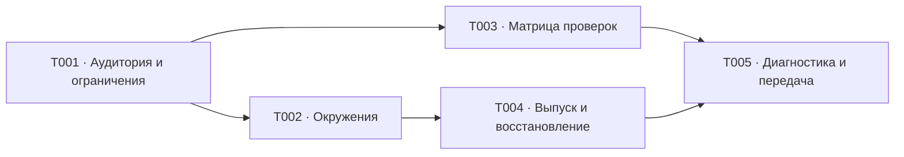

# E003. Условия выпуска, проверки и эксплуатация

## Границы текущего локального этапа

Внешние интеграции, удалённые окружения, DNS/TLS, доступы к серверу, внешней почте и приложениям Яндекс/VK отложены. E003/S01 остаются незавершёнными; отсутствие внешних доступов блокирует только отложенную внешнюю часть, а не локальную разработку и приёмку. Принятые проектные результаты T001/T003 и локально применимые правила безопасности, диагностики и восстановления используются без ожидания завершения T002/T004/T005. Возврат к внешним операциям требует отдельного разрешения владельца.

**Шаг:** S01 из [общего плана](../../README.md).

**Документ:** [PRD](./prd.md). Статус эпика ведётся только в
[реестре эпиков](../README.md).

## Текущая точка

- Подготовлены результаты всех пяти задач: [аудитория](./design/audience-and-constraints.md),
  [окружения](./design/environments-and-access.md), [матрица проверок](./design/acceptance-matrix.md),
  [выпуск и восстановление](./design/release-and-recovery.md), [диагностика и передача](./design/diagnostics-and-handoff.md).
- T001 и T003 приняты как проектные результаты. T002 не завершена: отсутствует
  подтверждение возможности подключения домена, почты и кабинетов владельца.
  T004/T005 подготовлены и проверены, их приёмка сохраняет зависимость от T002.
- Активных внешних действий нет. Продолжение текущего этапа — локальные проверки E006-T001 и продуктовые эпики. После отдельного разрешения на внешние работы вернуться к T002, подтвердить доступы наблюдаемыми результатами без секретов, сверить T004/T005 и завершить E003/S01.

## Зависимости и результат

Зависит от решений [E001](../e001-technical-design/README.md)
и мобильных потоков [E002](../e002-mobile-experience/README.md) в рамках S01.
Согласование аудитории и ограничений начинается параллельно с ними.
Входы — [бизнес-спеки](../../../requirements/README.md) и [бэклог](../../../backlog.md).

Результат — согласованные условия первой аудитории, план проверок и проект эксплуатации,
которые будут реализованы в S02 и проверены перед выпуском в S11.
Этот эпик не принимает технический стек: его согласуют с владельцем продукта в E001
до создания проекта и установки зависимостей.

## Задачи

После T001 задачи T002 и T003 допускают параллельное выполнение. T004 использует
окружения T002 и может готовиться одновременно с T003. T005 сверяет оба результата.
Технические входы E001 и мобильные схемы E002 подготовлены. Независимые части
зависимой задачи можно готовить заранее, но завершение требует принятых входов;
подготовка документа не снимает незакрытый критерий внешних доступов T002.

Статус задач ведётся только в этом реестре. Подготовка задач не означает выполнения эпика.

Все задачи выполняются как проектная работа без создания приложения.

| Готово | Задача | Статус | Заблокирована |
|---|---|---|---|
| [x] | [E003-T001. Согласовать аудиторию и эксплуатационные ограничения](./tasks/t001-audience-and-constraints.md) | Готов | нет; согласование с владельцем начинается параллельно с [E001-T001](../e001-technical-design/tasks/t001-constraints.md). |
| [ ] | [E003-T002. Спроектировать окружения и безопасные внешние доступы](./tasks/t002-environments-and-access.md) | Заблокирован | [E003-T001](tasks/t001-audience-and-constraints.md); согласованный стек [E001-T005](../e001-technical-design/tasks/t005-technology-stack.md) и проект доступа [E001-T006](../e001-technical-design/tasks/t006-access-and-trust.md). |
| [x] | [E003-T003. Согласовать матрицу проверок первой версии](./tasks/t003-acceptance-matrix.md) | Готов | [E003-T001](tasks/t001-audience-and-constraints.md); от E002 нужны схемы основных потоков и ограничения клавиатуры, а не итоговая сдача E002. |
| [ ] | [E003-T004. Спроектировать выпуск и восстановление данных](./tasks/t004-release-and-recovery.md) | Заблокирован | [E003-T002](tasks/t002-environments-and-access.md); проект сохранности [E001-T007](../e001-technical-design/tasks/t007-input-preservation.md). |
| [ ] | [E003-T005. Спроектировать диагностику и передать условия выпуска дальше](./tasks/t005-diagnostics-and-handoff.md) | Заблокирован | [E003-T003](tasks/t003-acceptance-matrix.md), [E003-T004](tasks/t004-release-and-recovery.md); итоговые решения E002 и содержательные результаты [E001-T004](../e001-technical-design/tasks/t004-history-recalculation.md)/[E001-T007](../e001-technical-design/tasks/t007-input-preservation.md). Завершения [E001-T008](../e001-technical-design/tasks/t008-design-handoff.md) не требуется: совместимость проверяется совместно. |
